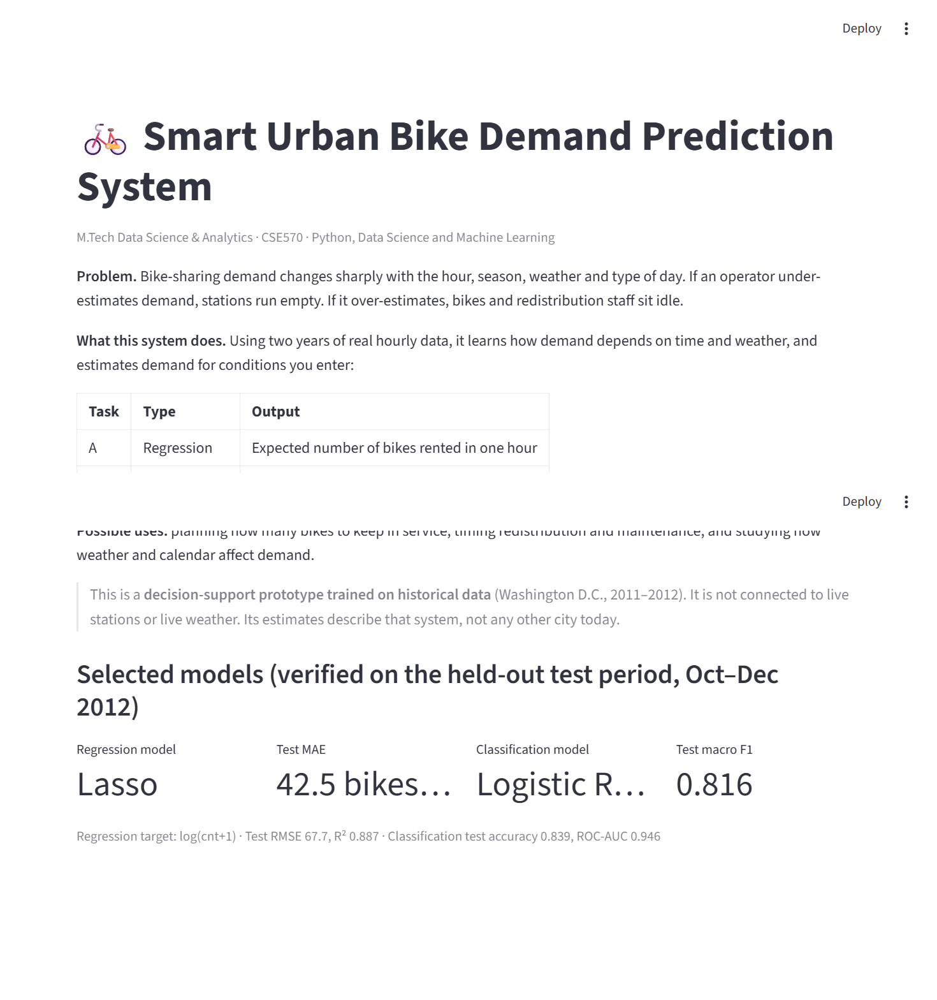
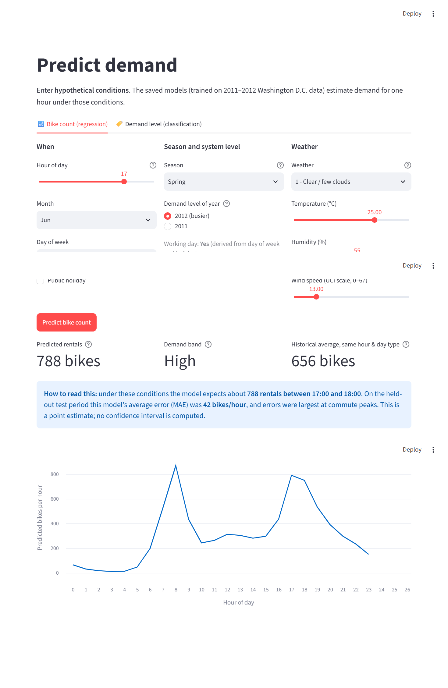
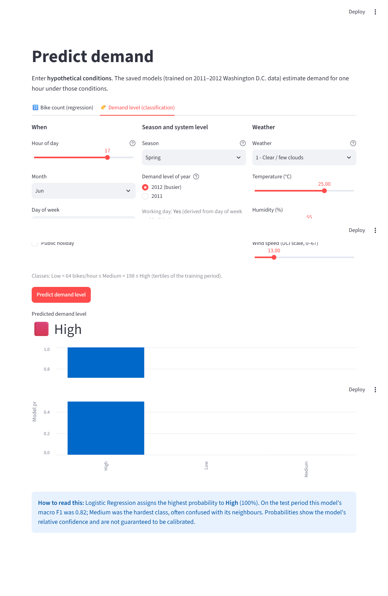

# 🚲 Smart Urban Bike Demand Prediction System

M.Tech Data Science & Analytics · CSE570 · Ayushi Pundir

A machine-learning project that predicts **how many bikes will be rented in an hour**
from the time, season and weather, and shows the predictions in a Streamlit dashboard.

**🌐 Live demo:** https://smart-urban-bike-demand-ayushi.streamlit.app/


## 1. Problem statement
Bike-sharing demand changes a lot by hour (office commute peaks at 8 am and 5–6 pm),
day type, season and weather. If an operator guesses too low, stations run out of
bikes. If it guesses too high, bikes and staff sit idle. This project learns these
patterns from real historical data and predicts demand in two ways:

| Task | Question | Type |
|---|---|---|
| A | How many bikes will be rented in this hour? | Regression |
| B | Will this hour be **Low** (< 64), **Medium** (64–197) or **High** (≥ 198) demand? | Classification |

It is a decision-support prototype trained on historical data. It is not connected to
live bikes or live weather.

## 2. Dataset
- **Source:** UCI Machine Learning Repository, *Bike Sharing* dataset,
  https://archive.ics.uci.edu/dataset/275/bike+sharing+dataset (licence CC BY 4.0)
- Real hourly data from Capital Bikeshare, Washington D.C., 2011–2012
- **17,379 rows**, 17 columns, 0 missing values, 0 duplicates. 165 hours have no record
  (for example the Hurricane Sandy shutdown, 29–30 Oct 2012).

| Column | Meaning | Used as |
|---|---|---|
| hr, weekday, workingday, holiday | hour (0–23), day of week, working day, holiday | input |
| season, mnth, yr | season (1 winter … 4 fall), month, year (0 = 2011, 1 = 2012) | input |
| weathersit, temp, hum, windspeed | weather type, temperature, humidity, wind | input |
| atemp | "feels-like" temperature | not used (almost the same as temp) |
| casual, registered | rentals by user type; they add up to cnt | **not used: data leakage** |
| cnt | total bikes rented in the hour | **target** |

## 3. Steps followed
1. **Load and check the data** (`src/data_loader.py`): correct columns, valid ranges,
   no missing values or duplicates.
2. **EDA** (`src/eda.py`): 8 graphs. Demand peaks at 8 am and 5–6 pm on working days,
   is lowest in winter, drops in rain, and grew 63% from 2011 to 2012.
3. **Feature engineering** (`src/feature_engineering.py`): merged the rare weather
   type 4 into 3, added hour × working-day, dropped `atemp`.
4. **Time-based split** (`src/preprocessing.py`): train Jan 2011–Jun 2012, validation
   Jul–Sep 2012, test Oct–Dec 2012. No random shuffling, so the model never sees the
   future.
5. **Regression** (`src/regression.py`): 7 models. Tuned with time-series
   cross-validation, best chosen on validation, tested once.
6. **Classification** (`src/classification.py`): 7 models, same process.
7. **Dashboard** (`app.py` + `src/predict.py`): enter conditions and get both predictions.
8. **Tests** (`tests/`): 30 automated checks with pytest.

## 4. Results (test period Oct–Dec 2012)

**Regression.** Best model: Lasso on log(cnt+1).

| Model | MAE (bikes) | RMSE | R² |
|---|---|---|---|
| **Lasso (selected)** | **42.49** | **67.72** | **0.887** |
| Multiple Linear | 68.63 | 94.82 | 0.779 |
| Simple Linear (temperature only) | 145.09 | 203.89 | −0.023 |
| Baseline (always the average) | 156.87 | 204.43 | −0.028 |

**Classification.** Best model: Logistic Regression.

| Model | Accuracy | Macro F1 | ROC-AUC |
|---|---|---|---|
| **Logistic Regression (selected)** | **0.839** | **0.816** | **0.946** |
| SVM | 0.837 | 0.822 | 0.944 |
| Random Forest | 0.833 | 0.816 | 0.948 |
| Decision Tree | 0.807 | 0.780 | 0.914 |
| Naive Bayes | 0.774 | 0.722 | 0.874 |
| KNN | 0.750 | 0.750 | 0.919 |
| Baseline (always "High") | 0.459 | 0.210 | 0.500 |

All tables and graphs: `outputs/metrics/`, `outputs/figures/` and the report
(`report/report.md`).

| Regression form | Classification form |
|---|---|
|  |  |

## 5. How to run
```bash
python -m venv .venv
.venv\Scripts\activate
pip install -r requirements.txt

python -m src.data_loader       # check the data
python -m src.eda               # make EDA graphs
python -m src.regression        # train regression models
python -m src.classification    # train classification models
python -m pytest -v             # run tests
streamlit run app.py            # open the dashboard
```

## 6. Project structure
```
app.py                 dashboard (frontend)
config/                settings: file paths, split dates, columns not to use
data/raw/              original UCI files (hour.csv, day.csv, Readme.txt)
src/data_loader.py     load and check the data
src/eda.py             EDA graphs
src/feature_engineering.py  new features
src/preprocessing.py   time-based split, scaling, encoding
src/regression.py      7 regression models
src/classification.py  7 classification models
src/evaluation.py      metric functions
src/predict.py         checks user input and makes predictions for the app
notebooks/             step-by-step notebooks for Units I–IV
tests/                 automated tests
outputs/               graphs and result tables
models/                saved model details
report/                project report
docs/                  flowchart and dashboard screenshots
```

## 7. Development timeline
| Date | What was done |
|---|---|
| 25 Oct 2026 | Installed Python, VS Code and Git; created the virtual environment and folders |
| 28 Oct 2026 | Downloaded the UCI data; wrote the config and data loader; verified 17,379 rows; first push to GitHub |
| 29 Oct 2026 | EDA graphs; preprocessing and 7 regression models; 7 classification models; dashboard; README |
| 30 Oct 2026 | methodology flowchart; project report |
| 5 Nov 2026 | Report title page |
| 6 Nov 2026 | Simplified the documentation into this README and the report |
| 11 Nov 2026 | Pinned library versions, deployed the dashboard on Streamlit Community Cloud, added submission evidence |


## 8. Limitations and future work
- Data is from one city (Washington D.C.) and is from 2011–2012, so the model does not
  directly apply to Indian cities or to today. No official hourly Indian bike-sharing
  data was found. The same code could be retrained on such data later.
- Uses the actual weather of the hour. Real use would need weather forecasts.
- No live data connection; future work could add live station and weather APIs.

## 9. Citation
Fanaee-T, H. (2013). *Bike Sharing* [Dataset]. UCI Machine Learning Repository. https://doi.org/10.24432/C5W894
Fanaee-T, H., & Gama, J. (2014). Event labeling combining ensemble detectors and background knowledge. *Progress in Artificial Intelligence, 2*(2–3), 113–127.
