# Smart Urban Bike Demand Prediction System Using Machine Learning

| | |
|---|---|
| **Student name** | [Your full name] |
| **Registration / Roll No.** | [Registration number] |
| **Programme** | M.Tech Data Science & Analytics |
| **Course code** | CSE570 – Python, Data Science and Machine Learning |
| **Section** | [Section] |
| **Faculty / Guide** | [Faculty name] |
| **Submission date** | [DD Month 2026] |

## 2. Abstract

Bike-sharing operators need to know how many bicycles will be rented under given
conditions so that stations are neither empty nor overstocked. This project builds an
end-to-end machine-learning system that estimates hourly rental demand from weather,
seasonal and calendar conditions. It uses the authentic UCI Bike Sharing dataset, which
contains 17,379 hourly observations from Capital Bikeshare, Washington D.C. (2011–2012).
Two tasks are solved: regression of the hourly rental count and three-class
classification of demand (Low / Medium / High), with class thresholds derived only from
the training period. The data were validated, explored, and transformed with leakage-safe
scikit-learn pipelines. They were split chronologically into training (Jan 2011 – Jun
2012), validation (Jul – Sep 2012) and test (Oct – Dec 2012) periods. Seven regression
approaches (baseline, simple, multiple and polynomial linear regression, Ridge, Lasso,
Elastic Net) and seven classifiers (baseline, Logistic Regression, KNN, Decision Tree,
Random Forest, SVM, Naive Bayes) were tuned with time-series cross-validation and selected
on the validation period. On the held-out test period, the selected Lasso model on a
log-transformed target achieved MAE 42.5 and RMSE 67.7 bikes per hour (R² 0.887),
reducing MAE by 73% compared with the mean baseline. The selected Logistic Regression
classifier achieved macro F1 0.816, accuracy 0.839 and one-vs-rest ROC-AUC 0.946. The
models are served through an interactive Streamlit dashboard. The system is a
decision-support prototype based on historical data from one city.

**Keywords:** demand prediction, bike sharing, regression, classification, regularisation,
time-series cross-validation, Streamlit

## 3. Introduction and Problem Statement

### 3.1 Background
Public bike-sharing systems let users rent a bicycle at one station and return it at
another. Usage depends strongly on time of day (commuting), day type (working day vs
weekend), season and weather. Operators must decide how many bicycles to keep in service
and when to redistribute or maintain them. Accurate demand estimates support these
decisions.

### 3.2 Problem definition
Given the hour, date-related attributes and weather conditions, estimate:
- **Task A (regression):** the total number of bikes rented in that hour (`cnt`).
- **Task B (classification):** whether the hour is a **Low**, **Medium** or **High**
  demand hour.

### 3.3 Objectives
1. Obtain and validate an authentic public dataset and document it.
2. Explore the data and engineer features without target leakage.
3. Implement and compare the regression and classification algorithms in the CSE570
   syllabus against baseline models, using a time-aware evaluation.
4. Select final models on validation data and report their performance once on a
   held-out test period.
5. Provide an interactive dashboard that applies the saved models to user-entered
   conditions.

**Success criteria:** the selected models must beat the Dummy baselines on the test
period (lower MAE/RMSE; higher macro F1); no leakage, verified by automated tests; a
working prediction interface.

### 3.4 Scope
In scope: hourly, system-wide demand for the historical Washington D.C. system;
user-supplied hypothetical conditions. Out of scope: live data feeds, station-level
prediction, weather forecasting, and claims about cost or emission reductions (not
measured).

### 3.5 Real-world applications
Fleet sizing, timing of redistribution and maintenance, staff planning, and analysis of
how weather and calendar effects drive urban mobility demand.

## 4. Dataset Description

### 4.1 Source and citation
- UCI Machine Learning Repository, *Bike Sharing* dataset (ID 275),
  https://archive.ics.uci.edu/dataset/275/bike+sharing+dataset, DOI 10.24432/C5W894,
  licence CC BY 4.0. Downloaded from the official download link by the student.
- Original data: Capital Bikeshare trip history (Washington D.C.), aggregated hourly and
  joined with weather and holiday information by the dataset author [1, 2].

### 4.2 Size and verified data quality (`hour.csv`)
| Property | Value |
|---|---|
| Rows (hours) | **17,379** (the UCI page states 17,389; the file contains 17,379) |
| Original columns | 17 |
| Period | 2011-01-01 to 2012-12-31 |
| Missing values | 0 |
| Duplicate rows / duplicate timestamps | 0 / 0 |
| Hours in the period vs rows | 17,544 vs 17,379 → **165 hours have no record** |

### 4.3 Features and targets
| Column | Meaning | Encoding | Role |
|---|---|---|---|
| season | Season | 1 winter, 2 spring, 3 summer, 4 fall | feature |
| yr | Year | 0 = 2011, 1 = 2012 | feature |
| mnth | Month | 1–12 | feature |
| hr | Hour | 0–23 | feature |
| holiday | Public holiday | 0/1 | feature |
| weekday | Day of week | 0 = Sunday … 6 = Saturday | feature |
| workingday | Not weekend and not holiday | 0/1 | feature |
| weathersit | Weather situation | 1 clear … 4 heavy rain/snow | feature (4 merged into 3) |
| temp | Temperature | (t + 8)/47, °C | feature |
| atemp | Feels-like temperature | (t + 16)/66 | dropped (r = 0.988 with temp) |
| hum | Humidity | %/100 | feature |
| windspeed | Wind speed | value/67 | feature |
| casual, registered | Rentals by user type | counts | **excluded – leakage** |
| cnt | Total rentals in the hour | casual + registered | **regression target** |
| instant, dteday | Row index, date | – | not used as features |

Engineered: `hr_workingday` (hour × day type, e.g. "W17"), `demand_level` (classification
target), `datetime` (for sorting/splitting only).

**Season coding check:** the `Readme.txt` in the zip lists 1 = spring, while the UCI web
page lists 1 = winter. In the data, season 1 contains months 12, 1, 2, 3 and has the
lowest demand. This confirms **1 = winter** (astronomical seasons).

### 4.4 Target distributions
- `cnt`: min 1, median 142, mean 189.46, max 977, skewness 1.28 (right-skewed).
- Demand levels (thresholds from training data, Section 5.7): training 33.3 / 33.2 /
  33.5% (Low/Medium/High); validation 22.6 / 17.3 / 60.1%; test 29.3 / 24.8 / 45.9%.

### 4.5 Limitations of the dataset
Historical (2011–2012) and from a single city; system-wide counts only (no stations);
weather is observed, not forecast; 165 hours absent, partly due to service shutdowns
(Hurricane Sandy, 29–30 Oct 2012 [15]; January 2011 snowstorm [16]). No official public
hourly bike-sharing dataset for an Indian city was found, so results do not transfer
directly to Indian conditions.

## 5. Data Preprocessing

### 5.1 Validation and data types
`src/data_loader.py` checks the 17 columns, the documented value ranges, non-negative
counts, `cnt = casual + registered` for every row, and parseable dates. The pipeline
stops if any check fails. `dteday` is converted from text to datetime, and rows are
sorted chronologically.

### 5.2 Missing values
There are no missing cell values, so no imputation was applied. This was confirmed
programmatically (notebook 01). The 165 absent hours were **not** filled in, because
inventing rental counts would fabricate data. User inputs in the app are validated and
rejected if missing or out of range.

### 5.3 Duplicates
No duplicate rows (ignoring the row index) and no duplicate timestamps.

### 5.4 Outliers
The IQR rule (Q1 = 40, Q3 = 281, upper fence 642.5) flags 505 hours (2.91%). These are
genuine commute-peak hours that passed all range checks. They were **kept**, and MAE is
reported alongside RMSE.

### 5.5 Encoding and scaling
Implemented with `ColumnTransformer` inside scikit-learn `Pipeline`s
(`src/preprocessing.py`):
- **Linear, KNN, SVM, Logistic Regression, Naive Bayes:** `StandardScaler` on temp, hum,
  windspeed; `OneHotEncoder` on season, mnth, hr, weekday, weathersit, hr_workingday;
  binary features passed through.
- **Polynomial / regularised regression:** polynomial expansion (degree 2–3) of the
  scaled numeric features only, to avoid an explosion of meaningless one-hot products.
- **Decision Tree, Random Forest:** raw values, no scaling (trees are scale-invariant).

### 5.6 Feature engineering and selection
Weather category 4 (3 hours) merged into 3; `hr_workingday` interaction added;
`atemp` removed (multicollinearity); target transformation `log(cnt + 1)` evaluated for
regression; Lasso / Elastic Net perform embedded feature selection.

### 5.7 Data splitting
| Split | Period | Rows | % |
|---|---|---|---|
| Train | 2011-01-01 → 2012-06-30 | 13,003 | 74.8 |
| Validation | 2012-07-01 → 2012-09-30 | 2,208 | 12.7 |
| Test | 2012-10-01 → 2012-12-31 | 2,168 | 12.5 |

Hyperparameters were tuned with `GridSearchCV` and 5-fold `TimeSeriesSplit` on the
training period. Every fold trains on earlier hours and validates on later hours.

### 5.8 Leakage prevention
1. `cnt`, `casual`, `registered`, `instant` and `dteday` are excluded centrally
   (`config/project_config.py`). An automated test checks that none of them is a feature.
2. All scalers and encoders are fitted inside pipelines, so they are refitted inside each
   CV fold and never see validation or test rows.
3. Demand thresholds come from training `cnt` only: Low < 64 ≤ Medium < 198 ≤ High.
4. Models were selected on validation. The test period was evaluated once, and the
   selection was not changed afterwards.
5. Engineered features use only values from the same row.

## 6. Exploratory Data Analysis

(Figures 01–08, `outputs/figures/`; full notes in `docs/eda_findings.md`.)

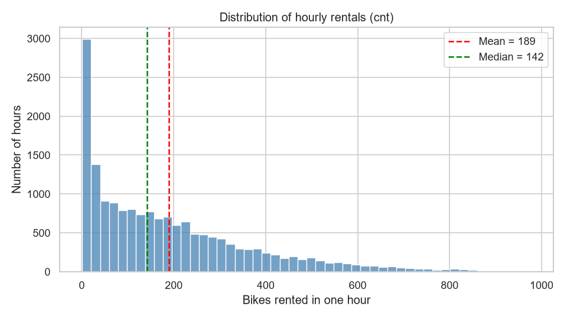

**Univariate.** `cnt` is right-skewed (skewness 1.28; mean 189.5 > median 142).

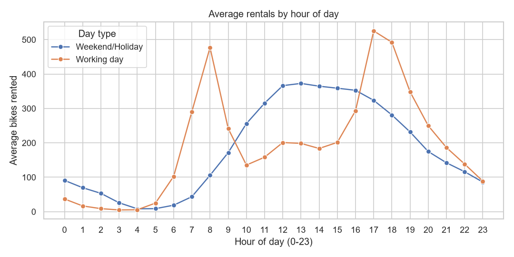

**Time of day.** Busiest hours are 17:00 (461.5), 18:00 (425.5) and 08:00 (359.0), the
commute peaks. Working days have two peaks; weekends have one midday hump. The average
level is similar (193.2 vs 181.4), but the shape differs, which motivated `hr_workingday`.

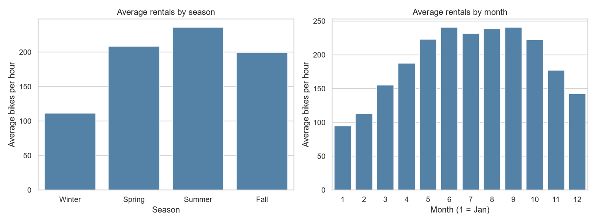
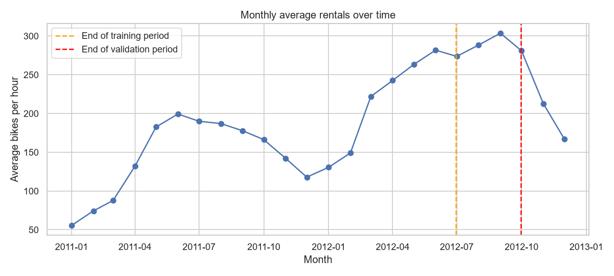

**Season and trend.** Average per hour: winter 111.1, spring 208.3, summer 236.0,
fall 198.9. 2012 averaged 234.7 vs 143.8 in 2011 (+63%). This growth justifies the
chronological split.

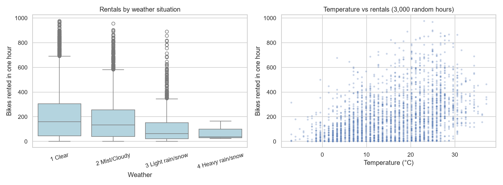

**Weather.** Hours per weather category: 11,413 / 4,544 / 1,419 / 3. Correlations with
cnt: temp +0.405, hum −0.323, weathersit −0.142, windspeed +0.093.

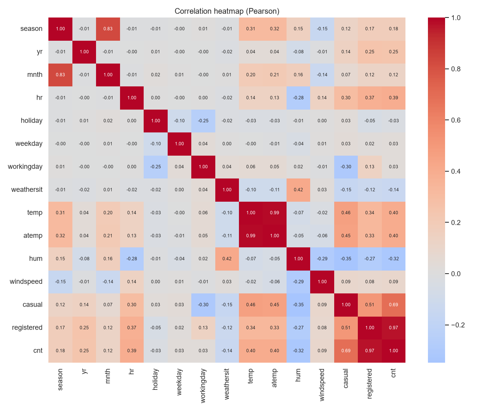

**Correlation.** registered (0.972) and casual (0.695) are highly correlated with cnt, which
confirms leakage. temp–atemp = 0.988. hr has r = 0.394 only because its effect is
non-linear.

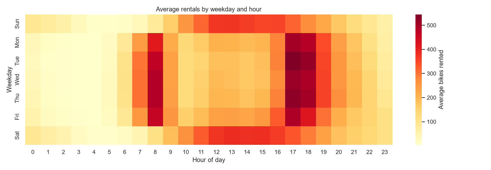
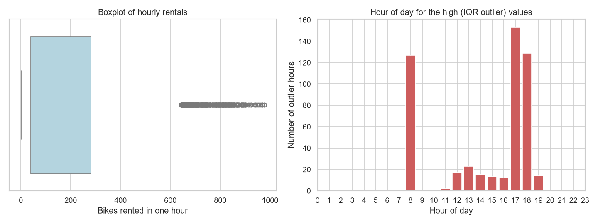

**Missing hours.** Concentrated on 2012-10-29 (23 h) and 2012-10-30 (13 h), during
Hurricane Sandy, when Capital Bikeshare suspended service, and on 26–27 Jan 2011
(snowstorm).

## 7. Methodology

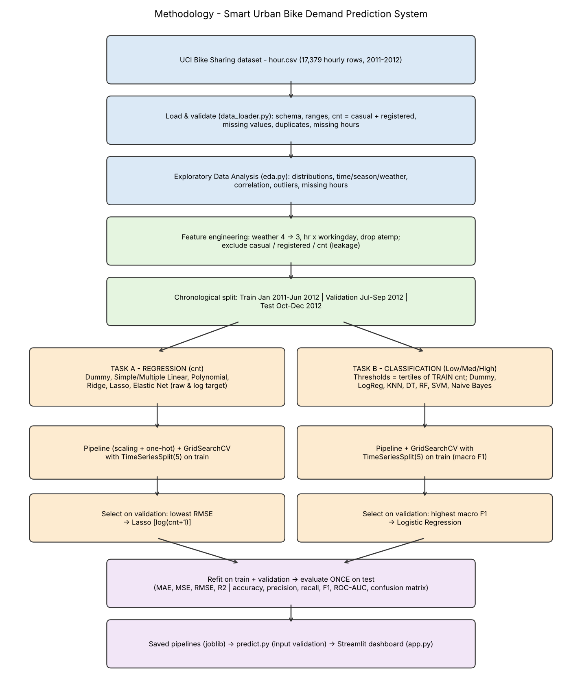

1. **Load & validate** the official file (`data_loader.py`).
2. **EDA** (`eda.py`) → documented decisions.
3. **Feature engineering** (`feature_engineering.py`) and **chronological split**
   (`preprocessing.py`).
4. **Model training**: each model is a Pipeline (preprocessing + estimator), tuned with
   GridSearchCV + TimeSeriesSplit(5) on the training period. Scoring: RMSE for
   regression, macro F1 for classification.
5. **Model selection** on the validation period.
6. **Final evaluation**: tuned configurations refit on train + validation, scored once
   on the test period.
7. **Persistence**: the selected pipelines are saved with joblib, with metadata
   (parameters, metrics, thresholds, package versions, seed 42).
8. **Deployment as a prototype**: `app.py` (Streamlit) calls `predict.py`, which validates
   inputs, converts real units to the UCI scale and applies the saved pipelines.

**Metrics.** Regression: MAE (mean absolute error in bikes), MSE, RMSE (penalises large
errors, same unit as cnt), R² (variance explained relative to predicting the mean).
Classification: accuracy, macro precision, recall and F1 (each class weighted equally),
one-vs-rest macro ROC-AUC, confusion matrix.

## 8. Model Development

### 8.1 Regression (Task A)
| Model | Preprocessing | Hyperparameters searched | Notes |
|---|---|---|---|
| DummyRegressor | – | strategy = mean | baseline |
| Simple Linear | scaled temp only | – | one predictor (highest linear correlation) |
| Multiple Linear | scaled + one-hot | – | all features |
| Polynomial | + PolynomialFeatures on numerics | degree ∈ {2, 3} | |
| Ridge (L2) | polynomial degree 2 | alpha ∈ {0.1, 1, 10, 100} | shrinks coefficients |
| Lasso (L1) | polynomial degree 2 | alpha ∈ {0.001 … 10} | sets some coefficients to 0 |
| Elastic Net | polynomial degree 2 | alpha ∈ {0.001 … 1}, l1_ratio ∈ {0.2, 0.5, 0.8} | L1 + L2 |

Each was trained on raw `cnt` and on `log(cnt + 1)` (via `TransformedTargetRegressor`).
Predictions are clipped at 0.

### 8.2 Classification (Task B)
| Model | Preprocessing | Hyperparameters searched |
|---|---|---|
| DummyClassifier | – | most frequent |
| Logistic Regression | scaled + one-hot | C ∈ {0.1, 1, 10} |
| KNN | scaled + one-hot | k ∈ {5, 15, 31}, weights ∈ {uniform, distance} |
| Decision Tree | raw | max_depth ∈ {5, 10, 15, None}, min_samples_leaf ∈ {1, 5, 20} |
| Random Forest (200 trees) | raw | max_depth ∈ {10, 20, None}, min_samples_leaf ∈ {1, 5} |
| SVM (RBF) | scaled + one-hot | C ∈ {0.1, 1, 10}; probabilities via CalibratedClassifierCV |
| Gaussian Naive Bayes | scaled + one-hot (dense) | var_smoothing ∈ {1e-9, 1e-6, 1e-3} |

The training classes are balanced by construction (tertiles), so no resampling or class
weighting was applied. Random seed 42 throughout.

## 9. Results and Model Comparison

### 9.1 Regression – validation (selection)
| Model | Target | Train RMSE | CV RMSE | Val MAE | Val RMSE | Val R² | Best params |
|---|---|---|---|---|---|---|---|
| **Lasso** | **log** | 52.92 | 85.61 | **47.55** | **74.44** | **0.8962** | α = 0.001 |
| Elastic Net | log | 52.60 | 85.25 | 47.65 | 75.36 | 0.8936 | α = 0.001, l1 = 0.2 |
| Ridge | log | 52.36 | 85.42 | 50.16 | 80.95 | 0.8772 | α = 0.1 |
| Polynomial | log | 52.37 | 85.43 | 50.20 | 81.03 | 0.8770 | degree 2 |
| Multiple Linear | log | 60.92 | 94.55 | 65.89 | 109.47 | 0.7755 | – |
| Polynomial | raw | 63.35 | 87.11 | 84.09 | 110.12 | 0.7729 | degree 2 |
| Ridge | raw | 63.35 | 87.15 | 84.10 | 110.13 | 0.7728 | α = 0.1 |
| Lasso | raw | 63.36 | 86.71 | 84.11 | 110.14 | 0.7728 | α = 0.001 |
| Elastic Net | raw | 63.41 | 87.41 | 84.45 | 110.60 | 0.7708 | α = 0.001, l1 = 0.8 |
| Multiple Linear | raw | 64.59 | 87.34 | 87.05 | 113.79 | 0.7575 | – |
| Simple Linear (temp) | raw | 146.15 | 157.13 | 174.29 | 227.34 | 0.0319 | – |
| Simple Linear (temp) | log | 162.55 | 174.17 | 183.84 | 252.84 | −0.1975 | – |
| Dummy (mean) | raw | 160.78 | 173.97 | 197.83 | 260.65 | −0.2726 | – |

### 9.2 Regression – test (evaluated once)
| Model | Target | MAE | MSE | RMSE | R² |
|---|---|---|---|---|---|
| **Lasso (selected)** | log | **42.49** | 4585.6 | **67.72** | **0.8872** |
| Ridge | log | 40.72 | 4415.7 | 66.45 | 0.8913 |
| Polynomial | log | 40.72 | 4416.6 | 66.46 | 0.8913 |
| Elastic Net | log | 41.56 | 4455.6 | 66.75 | 0.8904 |
| Multiple Linear | log | 43.04 | 4955.2 | 70.39 | 0.8781 |
| Multiple Linear | raw | 68.63 | 8991.7 | 94.82 | 0.7787 |
| Ridge / Polynomial / Lasso | raw | 70.66–70.68 | ≈9220 | 96.02–96.03 | 0.7731 |
| Elastic Net | raw | 70.85 | 9244.5 | 96.15 | 0.7725 |
| Simple Linear (temp) | raw | 145.09 | 41570.7 | 203.89 | −0.0230 |
| Dummy (mean) | raw | 156.87 | 41790.9 | 204.43 | −0.0284 |
| Simple Linear (temp) | log | 171.75 | 59342.2 | 243.60 | −0.4603 |

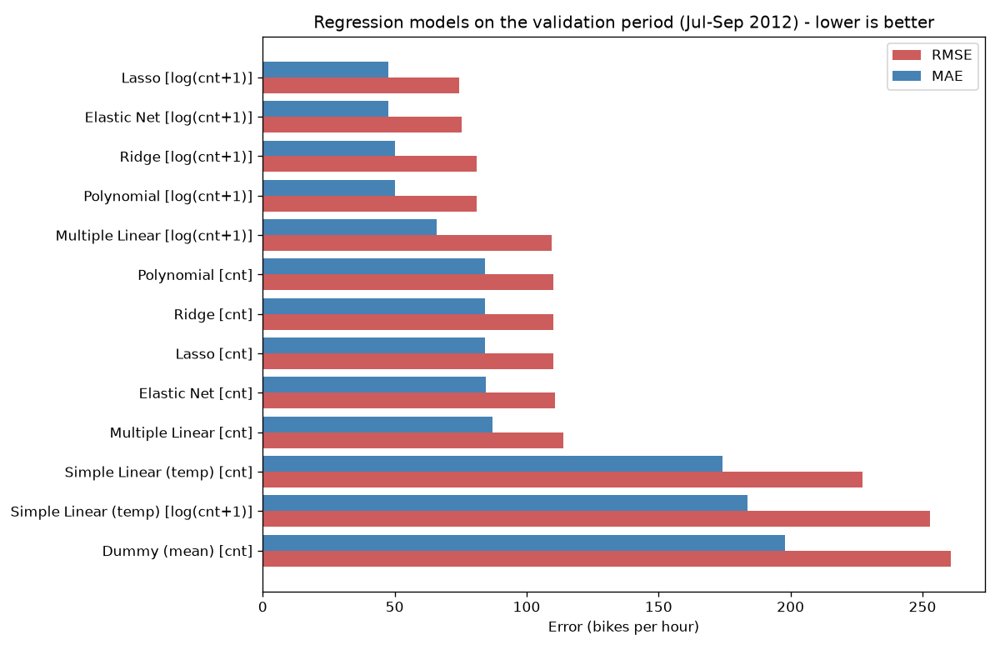
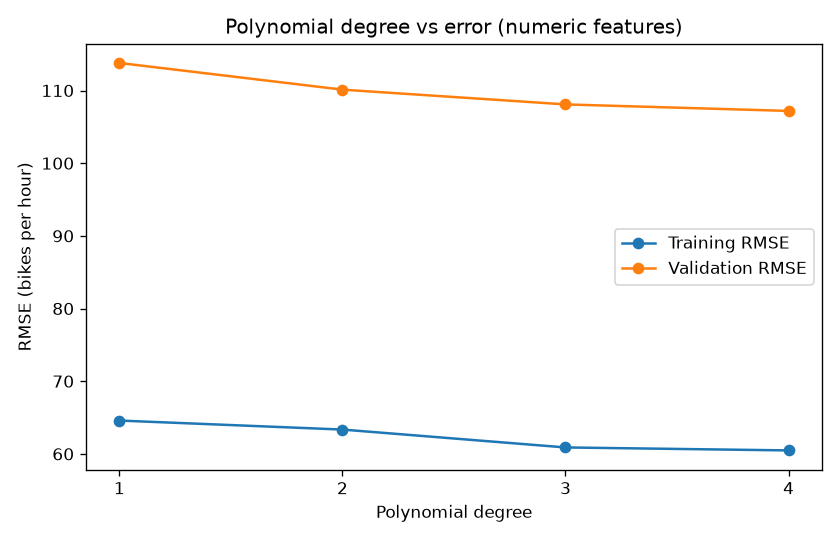
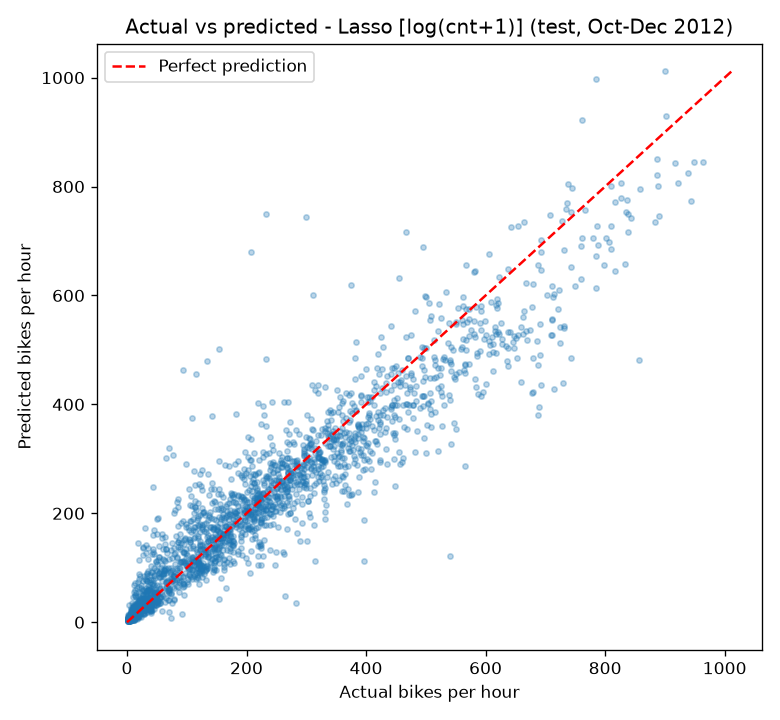
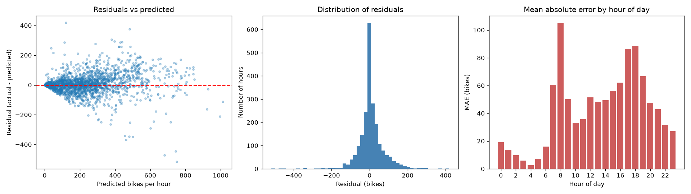
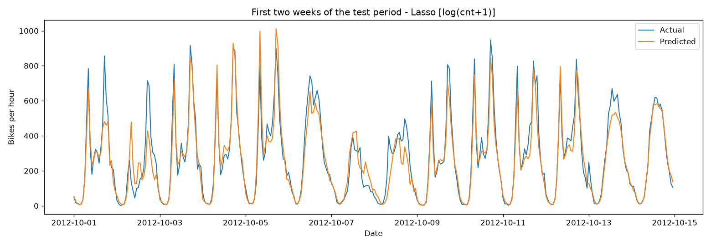
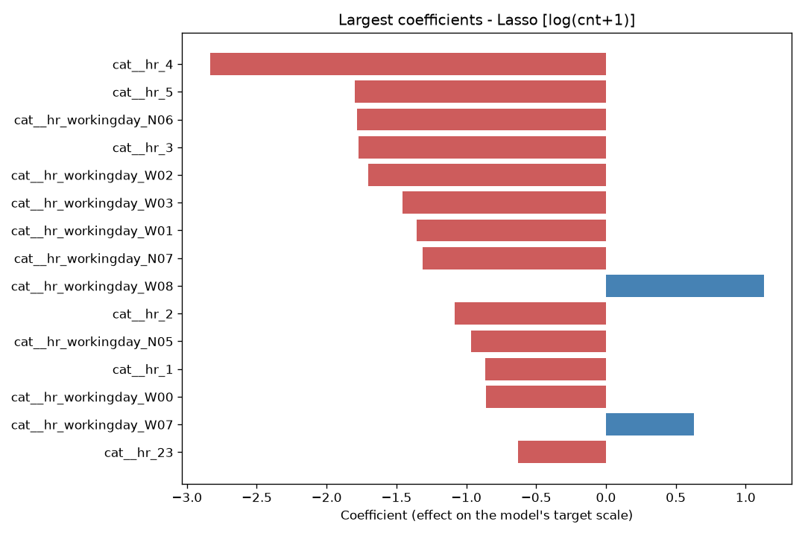

**Regression analysis.**
- The selected model reduces test MAE by 73% (156.87 → 42.49) and RMSE by 67% compared
  with the baseline.
- The log target was the most effective change (polynomial: val RMSE 110.12 → 81.03),
  consistent with the right-skewed, multiplicative nature of demand.
- Simple Linear Regression on temperature underfits (train RMSE 146). Hour and day type,
  not temperature alone, drive demand.
- Lasso set 37 of 110 coefficients to exactly 0.
- Polynomial degree curve (raw target): train/val RMSE 64.59/113.79 (degree 1),
  63.35/110.12 (2), 60.89/108.09 (3), 60.48/107.19 (4). Only three numeric features are
  expanded, so no clear overfitting appears up to degree 4.
- The best regularisation strengths were the smallest values in the grids. A wider grid
  is future work; it was not added after seeing test results.
- Error analysis: test MAE by hour is 2.5–19 bikes at night but 105.1 at 08:00 and
  86.4 / 88.5 at 17:00 / 18:00. The largest errors occur at commute peaks.
- **Why R² is not used alone:** from validation to test, the selected model's RMSE fell
  (74.4 → 67.7) but its R² also fell (0.896 → 0.887), because R² depends on the variance
  of the period. MAE and RMSE are in bikes per hour and are directly interpretable.
- **Model selection:** Lasso [log] was chosen on validation RMSE. On test, Ridge/Polynomial
  [log] were 1.3 bikes better. The choice was kept to avoid tuning on the test set; the
  top four log-target models are practically equivalent.

### 9.3 Classification – validation (selection)
| Model | CV F1 | Train F1 | Accuracy | Precision | Recall | **Macro F1** | ROC-AUC |
|---|---|---|---|---|---|---|---|
| **Logistic Regression (C = 10)** | 0.7819 | 0.8715 | 0.9207 | 0.8968 | 0.8881 | **0.8922** | 0.9800 |
| Random Forest | 0.7279 | 1.0000 | 0.9004 | 0.8612 | 0.8924 | 0.8743 | 0.9767 |
| Decision Tree (depth 10, leaf 20) | 0.7494 | 0.8627 | 0.8981 | 0.8579 | 0.8744 | 0.8656 | 0.9719 |
| Naive Bayes | 0.7741 | 0.6649 | 0.8922 | 0.8434 | 0.8673 | 0.8543 | 0.9655 |
| SVM (RBF, C = 10) | 0.7354 | 0.9753 | 0.8718 | 0.8370 | 0.8751 | 0.8493 | 0.9563 |
| KNN (k = 15, distance) | 0.6883 | 1.0000 | 0.7948 | 0.7757 | 0.8377 | 0.7824 | 0.9462 |
| Dummy | 0.1492 | 0.1671 | 0.6010 | 0.2003 | 0.3333 | 0.2503 | 0.5000 |

### 9.4 Classification – test (evaluated once)
| Model | Accuracy | Precision | Recall | **Macro F1** | ROC-AUC |
|---|---|---|---|---|---|
| **Logistic Regression (selected)** | 0.8386 | 0.8374 | 0.8041 | **0.8160** | 0.9461 |
| SVM (RBF) | 0.8372 | 0.8285 | 0.8183 | 0.8217 | 0.9441 |
| Random Forest | 0.8326 | 0.8197 | 0.8133 | 0.8158 | 0.9477 |
| Decision Tree | 0.8072 | 0.7851 | 0.7786 | 0.7802 | 0.9142 |
| KNN | 0.7500 | 0.7624 | 0.7669 | 0.7498 | 0.9186 |
| Naive Bayes | 0.7735 | 0.7883 | 0.7114 | 0.7217 | 0.8736 |
| Dummy | 0.4589 | 0.1530 | 0.3333 | 0.2097 | 0.5000 |

Per class (selected model, test): Low P 0.962 / R 0.838 / F1 0.896 (636 hours);
Medium 0.727 / 0.615 / 0.666 (537); High 0.823 / 0.960 / 0.886 (995).

Confusion matrix (rows actual, columns predicted; Low/Medium/High):
`[[533, 86, 17], [19, 330, 188], [2, 38, 955]]`

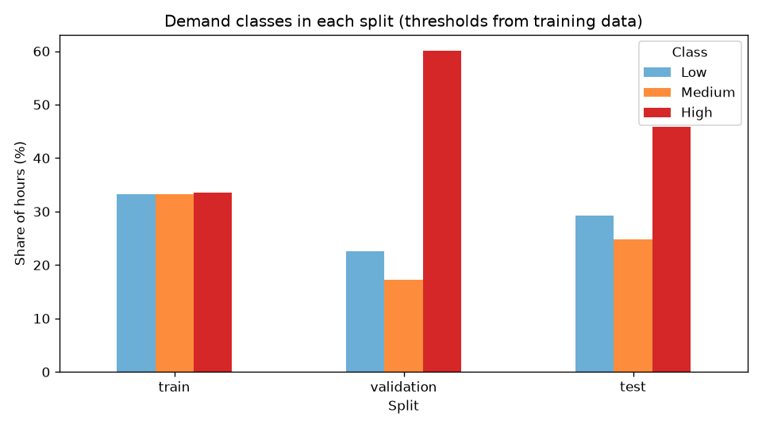
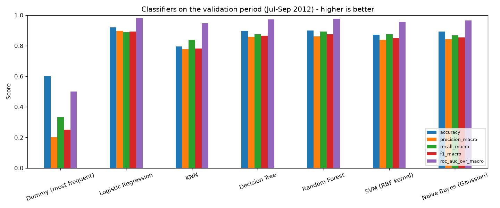
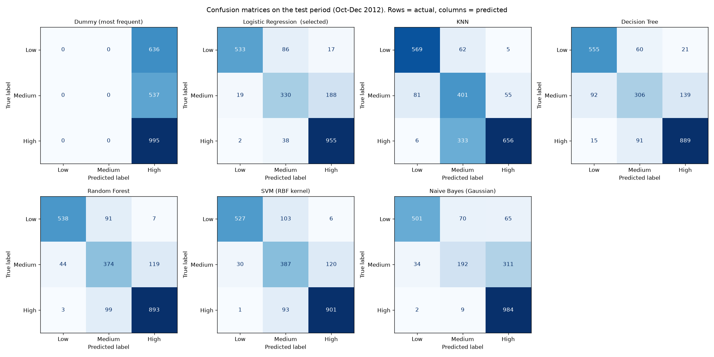
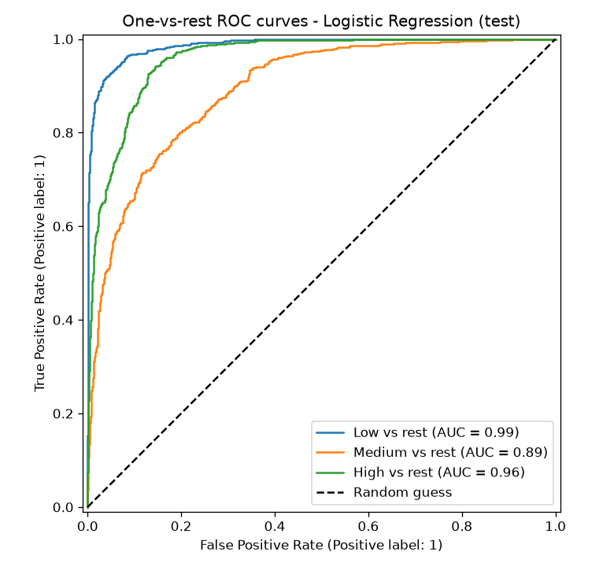
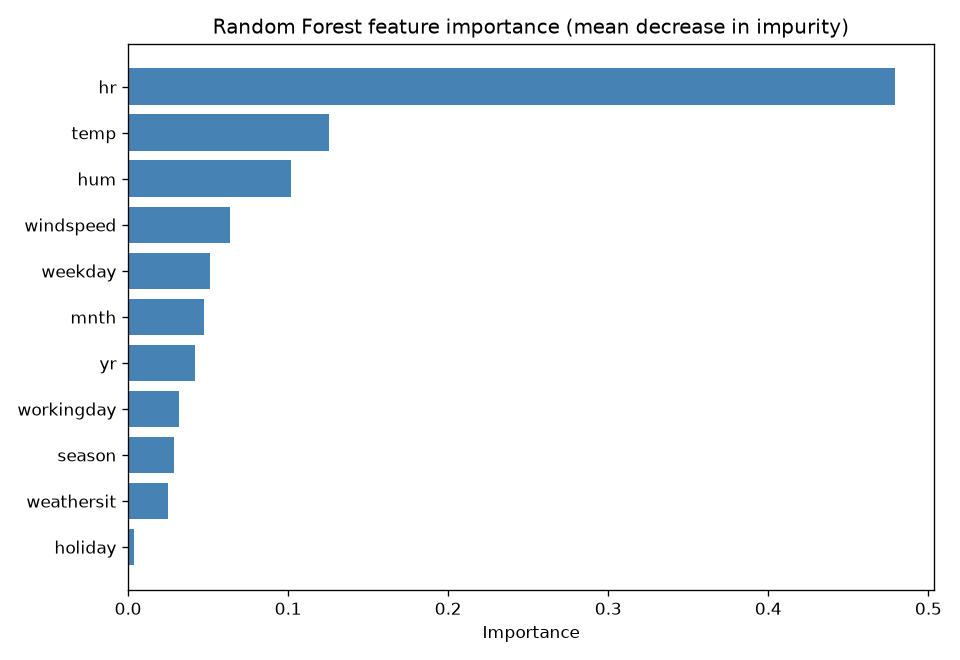

**Classification analysis.**
- Accuracy alone is misleading: on validation, the Dummy reaches 60.1% accuracy (it
  always predicts High) but only 0.25 macro F1.
- The class mix shifts (validation 60.1% High) because demand grew while the thresholds
  stay fixed from training. Recomputing them on test data would leak information.
- Medium is the hardest class (F1 0.67). Errors mostly fall into the neighbouring class
  (188 Medium → High). Low↔High confusions occur in only 19 of 2,168 hours.
- Overfitting: Random Forest and KNN reach train F1 = 1.000 but 0.874 / 0.782 on
  validation. The Decision Tree constrained by min_samples_leaf = 20 shows a small gap.
- Logistic Regression benefits from the one-hot hour × day-type feature. KNN suffers in
  the ~110-dimensional one-hot space. Naive Bayes' independence assumption is violated
  (hr and hr_workingday overlap).
- Scaling matters for KNN: in a live experiment on the real data (notebook 04), KNN on
  raw-unit features was compared with and without StandardScaler. [Insert the two macro
  F1 values printed by your notebook here.]
- Random Forest importance: hr 0.479, temp 0.126, hum 0.102, windspeed 0.064, weekday
  0.051 … holiday 0.004. Impurity importance can overstate continuous features.
- SVM was marginally better on test (0.8217 vs 0.8160). Logistic Regression is kept,
  because it was selected on validation.

### 9.5 Dashboard
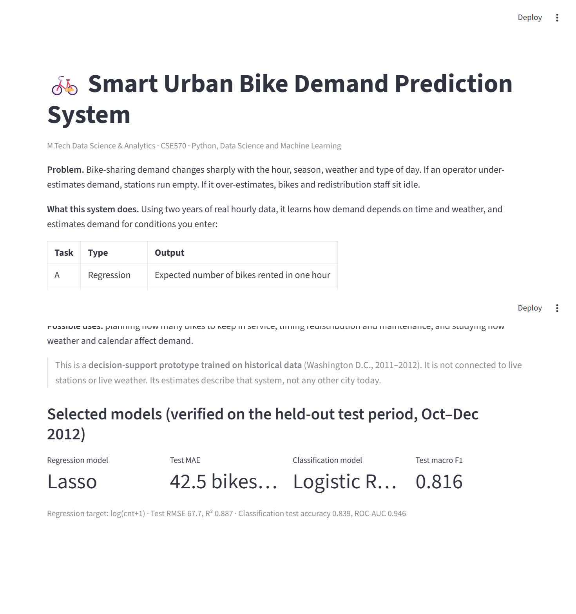
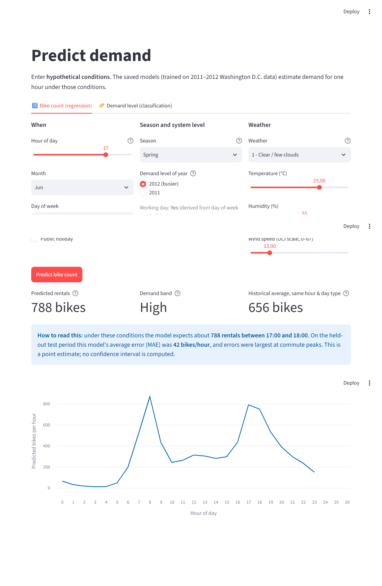
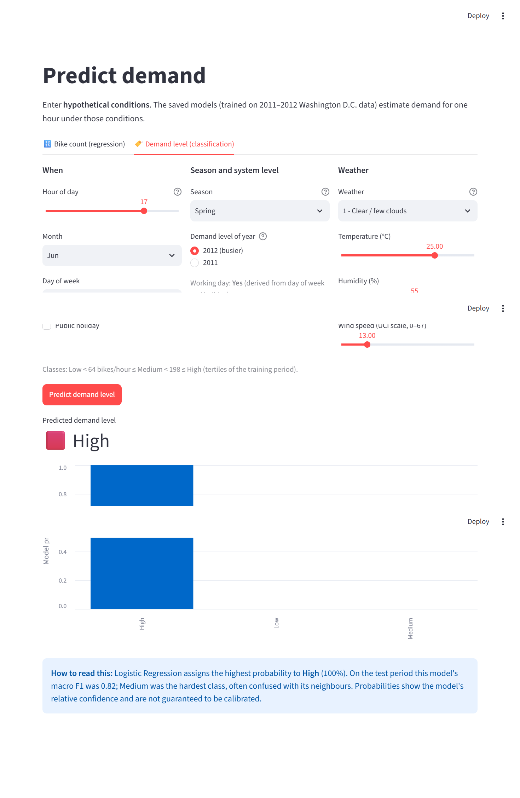

Example (regression form): Wednesday, June, 17:00, 2012 level, clear weather, 25 °C,
55% humidity → predicted 788 bikes (High). The historical average for the same hour and
day type in 2012 is 656.

### 9.6 Testing
30 automated pytest tests pass. They cover dataset schema validation, leakage exclusion,
chronological split boundaries, feature engineering, input validation (out-of-range and
wrong-type inputs rejected), unit conversion, saved-model loading and predictions.

## 10. Conclusion and Limitations

### 10.1 Findings
Hourly bike demand is driven mainly by hour of day and its interaction with day type,
followed by temperature, humidity, season and the system's growth. A regularised linear
model on a log-transformed target, with one-hot calendar features, predicts hourly demand
with a test MAE of 42.5 bikes (R² 0.887). A regularised Logistic Regression classifies
demand levels with macro F1 0.816. Both clearly outperform the baselines. A careful
evaluation design (chronological split, time-series CV, training-only thresholds, a
single test evaluation) was essential for honest results.

### 10.2 Practical relevance
The dashboard lets a planner explore expected demand for chosen conditions and see the
daily demand profile. It serves as a decision-support prototype for fleet and
redistribution planning.

### 10.3 Limitations
- Historical, single-city data (Washington D.C., 2011–2012); not directly transferable to
  other cities or to the present.
- Observed weather is used instead of forecasts.
- The year feature only covers 2011/2012, so growth cannot be extrapolated.
- Classification thresholds are fixed, while demand levels shift over time.
- The test period covers a single season and includes the Hurricane Sandy shutdown.
- Point predictions only; no prediction intervals.
- System-wide demand only.

### 10.4 Future improvements
Retrain on official Indian city data with local features (monsoon, festivals); live
integration with an operator station feed (e.g. GBFS) and a weather-forecast API with
scheduled retraining; gradient-boosting regressors; wider regularisation grids;
prediction intervals; permutation importance; ordinal classification; station-level
forecasting.

## 11. References
1. Fanaee-T, H. (2013). *Bike Sharing* [Dataset]. UCI Machine Learning Repository. https://doi.org/10.24432/C5W894
2. Fanaee-T, H., & Gama, J. (2014). Event labeling combining ensemble detectors and background knowledge. *Progress in Artificial Intelligence, 2*(2–3), 113–127. https://doi.org/10.1007/s13748-013-0040-3
3. Pedregosa, F., et al. (2011). Scikit-learn: Machine learning in Python. *Journal of Machine Learning Research, 12*, 2825–2830.
4. Harris, C. R., et al. (2020). Array programming with NumPy. *Nature, 585*, 357–362.
5. McKinney, W. (2010). Data structures for statistical computing in Python. *Proceedings of the 9th Python in Science Conference*, 56–61.
6. Hunter, J. D. (2007). Matplotlib: A 2D graphics environment. *Computing in Science & Engineering, 9*(3), 90–95.
7. Waskom, M. L. (2021). seaborn: Statistical data visualization. *Journal of Open Source Software, 6*(60), 3021.
8. Hoerl, A. E., & Kennard, R. W. (1970). Ridge regression: Biased estimation for nonorthogonal problems. *Technometrics, 12*(1), 55–67.
9. Tibshirani, R. (1996). Regression shrinkage and selection via the lasso. *Journal of the Royal Statistical Society: Series B, 58*(1), 267–288.
10. Zou, H., & Hastie, T. (2005). Regularization and variable selection via the elastic net. *Journal of the Royal Statistical Society: Series B, 67*(2), 301–320.
11. Breiman, L. (2001). Random forests. *Machine Learning, 45*, 5–32.
12. Cortes, C., & Vapnik, V. (1995). Support-vector networks. *Machine Learning, 20*, 273–297.
13. Hastie, T., Tibshirani, R., & Friedman, J. (2009). *The Elements of Statistical Learning* (2nd ed.). Springer.
14. Hyndman, R. J., & Athanasopoulos, G. (2021). *Forecasting: Principles and Practice* (3rd ed.). OTexts. https://otexts.com/fpp3/
15. Bates Area Civic Association (28 Oct 2012). No DC Circulator and Capital Bikeshare service on Monday. https://batesareacivicassociation.org/2012/10/28/no-dc-circulator-and-capital-bikeshare-service-on-monday/
16. O'Brien, O. (Jan 2011). Washington DC storm bike share shutdown. https://oobrien.com/2011/01/washington-dc-storm-bike-share-shutdown/
17. Streamlit documentation. https://docs.streamlit.io · scikit-learn user guide. https://scikit-learn.org/stable/user_guide.html

## 12. GitHub and LinkedIn Evidence

| Item | Value |
|---|---|
| GitHub repository | [https://github.com/USERNAME/smart-urban-bike-demand] |
| LinkedIn post | [URL of your LinkedIn post] |
| Number of commits / pull requests | [from GitHub, on the submission date] |
| Stars / LinkedIn likes / comments | [values on the submission date] |

**Screenshots (dated):**
- [Insert screenshot: GitHub repository home page, showing the date]
- [Insert screenshot: commit history (`Commits` page)]
- [Insert screenshot: contribution graph on your GitHub profile]
- [Insert screenshot: LinkedIn post with likes/comments, showing the date]

**Development timeline** (from `docs/development_log.md`): environment setup (25 Oct
2026); data loader, configuration and data dictionary (28 Oct); EDA, regression,
classification and dashboard (29 Oct); README, notebooks, report and documentation
(30 Oct onward). Commit timestamps in the repository are the authoritative record.
