# Smart Urban Bike Demand Prediction System Using Machine Learning

| | |
|---|---|
| **Student name** | Ayushi Pundir |
| **Registration No.** | 12629808 |
| **Programme** | M.Tech Data Science & Analytics |
| **Course code** | CSE570 – Machine Learning with Python |
| **Section** | K3P26DS |
| **Submission date** | 12 Nov 2026 |

<div style="page-break-after: always;"></div>

## 2. Abstract

Bike-sharing services have become a useful part of urban transportation. However, managing the number of available bicycles can be challenging because the demand changes throughout the day depending on factors such as weather, season, and working days. If too few bicycles are available, users may not find one when they need it. On the other hand, keeping too many bicycles at a station can also create management problems.

In this project, I developed a machine learning system to predict the hourly demand for rental bicycles. For this, I used the UCI Bike Sharing dataset, which contains 17,379 hourly records from the Capital Bikeshare system in Washington D.C., covering the years 2011 and 2012.

The project focuses on two machine learning tasks. The first is regression, where the model predicts the number of bicycles that may be rented in a particular hour. The second is classification, where the same demand is divided into three categories: Low, Medium, and High. I experimented with different regression and classification algorithms and compared their performance using a time-based training, validation, and testing approach.

Among the regression models, Lasso Regression with a log-transformed target gave an MAE of 42.49 and an RMSE of 67.72 on the test data, with an R² score of 0.8872. For classification, Logistic Regression achieved a macro F1-score of 0.8160 and an accuracy of 0.8386. Both selected models performed better than their baseline models.

Finally, I connected the trained models to an interactive Streamlit dashboard. It allows users to enter different weather and time-related conditions and view the predicted bike demand. The project demonstrates how machine learning can help understand historical bike usage patterns and support better planning of bike-sharing services.

**Keywords:** demand prediction, bike sharing, regression, classification, regularisation, time-series cross-validation, Streamlit

<div style="page-break-after: always;"></div>

## 3. Introduction and Problem Statement

### 3.1 Background

Bike-sharing is a convenient transportation option in many cities. People can rent a bicycle from one location and return it at another, which makes short-distance travel easier. However, the number of people using these services is not the same throughout the day.

For example, more people may rent bicycles during morning and evening office hours, while the demand may be different during weekends or holidays. Weather also plays an important role. People may prefer cycling when the weather is pleasant, but demand can decrease during heavy rain or uncomfortable conditions.

Because of these changes, bike-sharing operators need to plan how many bicycles should be available and when they should be moved between stations. This project focuses on using historical data and machine learning to estimate hourly bike demand. The aim is to understand the patterns behind bicycle rentals and build models that can make useful predictions.

### 3.2 Problem Definition

The main problem addressed in this project is to estimate bicycle rental demand using information such as the hour, date, season, and weather conditions.

This problem is divided into two tasks:

- **Task A – Regression:** Predict the total number of bicycles rented during a particular hour. The target variable for this task is `cnt`.
- **Task B – Classification:** Identify whether the demand during a particular hour is Low, Medium, or High.

By solving both tasks, the project provides two different ways to understand and estimate bike-sharing demand.

### 3.3 Objectives

The main objectives of this project are:

1. To collect and understand a real-world bike-sharing dataset from the UCI Machine Learning Repository.
2. To explore the data and identify how time, weather, and calendar conditions affect bicycle rentals.
3. To build and compare different regression and classification models.
4. To evaluate the models using a chronological data split so that future records are not used while training on past records.
5. To develop an interactive dashboard where users can enter conditions and view the predicted bike demand.

**Success Criteria:** The final models should perform better than the baseline models on unseen test data. The project should also avoid data leakage and provide a working dashboard for predictions.

### 3.4 Scope

This project focuses on predicting hourly bike rental demand for the Capital Bikeshare system in Washington D.C. using historical data from 2011 and 2012. It includes data analysis, preprocessing, feature engineering, model training, evaluation, and dashboard development.

The project also allows users to enter hypothetical weather and time-related conditions through the dashboard. However, it does not use live bike-sharing data, predict demand for individual stations, or forecast future weather. It also does not measure actual reductions in operating costs or carbon emissions.

### 3.5 Real-World Applications

The predictions from this project can be useful in several ways. Bike-sharing operators can use demand estimates to plan the number of bicycles required during busy hours. They can also use the information to decide when bicycles may need to be moved between locations.

The analysis can help with staff planning, maintenance scheduling, and understanding how weather and calendar conditions influence bicycle usage. Although this project is based on historical data, it provides an example of how machine learning can support planning decisions in urban transportation.

## 4. Dataset Description

### 4.1 Source and Citation

For this project, I selected the Bike Sharing dataset available on the UCI Machine Learning Repository (Dataset ID 275). The dataset can be accessed through the official UCI website:

[UCI Bike Sharing Dataset](https://archive.ics.uci.edu/dataset/275/bike+sharing+dataset)

The dataset was originally created using Capital Bikeshare rental information from Washington D.C. It contains hourly bike rental records along with weather, seasonal, and holiday-related information. These additional details make it suitable for studying the factors that influence bicycle demand [1, 2].

I downloaded the dataset from the official source and used the `hour.csv` file for the experiments in this project.

### 4.2 Size and Verified Data Quality (`hour.csv`)

| Property | Value |
|---|---|
| Rows (hours) | **17,379** (the UCI page states 17,389; the file contains 17,379) |
| Original columns | 17 |
| Period | 2011-01-01 to 2012-12-31 |
| Missing values | 0 |
| Duplicate rows / duplicate timestamps | 0 / 0 |
| Hours in the period vs rows | 17,544 vs 17,379 → **165 hours have no record** |

### 4.3 Features and Targets

| Column | Meaning | Encoding | Role |
|---|---|---|---|
| season | Season | 1 winter, 2 spring, 3 summer, 4 fall | feature |
| yr | Year | 0 = 2011, 1 = 2012 | feature |
| mnth | Month | 1–12 | feature |
| hr | Hour | 0–23 | feature |
| holiday | Public holiday | 0/1 | feature |
| weekday | Day of week | 0 = Sunday … 6 = Saturday | feature |
| workingday | Not weekend and not holiday | 0/1 | feature |
| weathersit | Weather situation | 1 clear … 4 heavy rain/snow | feature (4 merged into 3) |
| temp | Temperature | (t + 8)/47, °C | feature |
| atemp | Feels-like temperature | (t + 16)/66 | dropped (r = 0.988 with temp) |
| hum | Humidity | %/100 | feature |
| windspeed | Wind speed | value/67 | feature |
| casual, registered | Rentals by user type | counts | **excluded – leakage** |
| cnt | Total rentals in the hour | casual + registered | **regression target** |
| instant, dteday | Row index, date | – | not used as features |

Apart from the original columns, I also created a few additional features during preprocessing. The `hr_workingday` feature combines the hour of the day with the working-day information. This helps the models understand that demand at the same hour can be different on a working day and a weekend.

The `demand_level` column was created for the classification task, while `datetime` was used to arrange the records in chronological order and divide the dataset into training, validation, and test periods.

I also checked the season information carefully because the season coding mentioned in the dataset documentation was not consistent across the files. After checking the months present in the data, I used the interpretation where season 1 represents winter.

### 4.4 Target Distributions

The target variable `cnt` represents the total number of bicycles rented in an hour. Its values range from 1 to 977, with a median of 142 and a mean of approximately 189.46. The mean is higher than the median, which indicates that the distribution is right-skewed. In simple terms, most hours have comparatively lower rental counts, while a smaller number of busy hours have much higher demand.

For classification, the rental counts were divided into three demand categories: Low, Medium, and High. The thresholds were calculated using only the training data. As a result, the proportion of these categories is not exactly the same in the training, validation, and test periods.

### 4.5 Limitations of the Dataset

While the dataset is useful for studying bike-sharing demand, it also has some limitations. First, it contains historical records from only one city, Washington D.C., and covers the period from 2011 to 2012. Therefore, the patterns found in this dataset may not represent the present-day demand of other cities.

Another limitation is that the dataset contains system-wide rental counts instead of station-level information. It also provides observed weather conditions rather than future weather forecasts.

There are 165 hours without records in the selected period. Some of these missing hours are related to service interruptions during Hurricane Sandy in October 2012 and a snowstorm in January 2011. These hours were not filled with estimated values.

I could not find an official public hourly bike-sharing dataset for an Indian city for this project. Because of this, the results should not be directly applied to Indian cities without further testing on local data.

## 5. Data Preprocessing

### 5.1 Validation and Data Types

Before training the models, I first checked whether the dataset was in the expected format. The data loader in `src/data_loader.py` verifies the column names, value ranges, rental counts, and date information.

It also checks whether the total rental count is equal to the sum of casual and registered rentals for every row. The date column `dteday` is converted into datetime format, and the records are sorted from the earliest date to the latest date. If any important validation check fails, the pipeline stops instead of continuing with incorrect data.

### 5.2 Missing Values

During data inspection, I found that there were no missing cell values in the selected dataset. Therefore, there was no need to apply an imputation method.

However, 165 hourly records were absent from the overall time period. I decided not to create artificial records for these missing hours because doing so would require estimating rental counts that were not present in the original data.

The dashboard also includes input validation. If a user enters a missing or out-of-range value, the application does not accept that input.

### 5.3 Duplicates

I checked the dataset for duplicate rows and repeated timestamps. No duplicate rows or duplicate timestamps were found. This means that the same hourly record was not repeated in the dataset.

### 5.4 Outliers

I used the Interquartile Range (IQR) method to identify unusually high rental counts. This method flagged 505 hours, which represents approximately 2.91% of the dataset.

After checking these records, I decided to keep them. Many of these high values represent genuine periods of heavy bicycle usage, especially during commuting hours. Removing them could have caused the models to miss important demand patterns. For this reason, I retained these observations and used both MAE and RMSE to evaluate prediction errors.

### 5.5 Encoding and Scaling

Different machine learning algorithms handle numerical and categorical data in different ways. Therefore, I used separate preprocessing steps depending on the model.

For Linear Regression, KNN, SVM, Logistic Regression, and Naive Bayes, I applied `StandardScaler` to numerical weather-related features and `OneHotEncoder` to categorical features such as season, month, hour, weekday, and weather situation.

For Polynomial Regression and regularised regression models, polynomial features of degree 2 and 3 were created using the scaled numerical features. I limited this expansion to numerical columns to avoid creating too many unnecessary combinations of categorical features.

Decision Tree and Random Forest models were trained using the original feature values without scaling because tree-based algorithms do not depend on the scale of the input features.

These preprocessing steps were implemented using `ColumnTransformer` and `Pipeline` from scikit-learn.

### 5.6 Feature Engineering and Selection

Some changes were made to the original features to make them more useful for model training.

Weather category 4 contained only three observations, so it was combined with category 3. I also created the `hr_workingday` feature because the relationship between the hour and the type of day can affect bicycle demand.

The `atemp` column was removed because it was highly correlated with `temp` (correlation of 0.988). Keeping both could introduce unnecessary overlap between the features.

For regression, I also tested a log transformation of the target variable using `log(cnt + 1)`. Lasso and Elastic Net were used to perform regularisation, which helps control the contribution of less useful features.

### 5.7 Data Splitting

| Split | Period | Rows | % |
|---|---|---:|---:|
| Train | 2011-01-01 → 2012-06-30 | 13,003 | 74.8 |
| Validation | 2012-07-01 → 2012-09-30 | 2,208 | 12.7 |
| Test | 2012-10-01 → 2012-12-31 | 2,168 | 12.5 |

Since the dataset contains records collected over time, I did not divide it randomly. Instead, I arranged the records chronologically and created three separate parts.

The training data was used to train the models, the validation data was used to compare their performance and select the final models, and the test data was kept aside for the final evaluation.

I used `GridSearchCV` along with five-fold `TimeSeriesSplit` for hyperparameter tuning. In this approach, each validation fold comes after its corresponding training period. This helps maintain the order of time and makes the evaluation more realistic.

### 5.8 Leakage Prevention

Data leakage can make a machine learning model appear more accurate than it actually is. To avoid this problem, I followed these steps:

1. The columns `cnt`, `casual`, `registered`, `instant`, and `dteday` were excluded from the input features. The target column and rental components were not allowed to enter the model as predictors.
2. Scaling and encoding were performed inside scikit-learn pipelines. This ensures that preprocessing is fitted only on the training portion of each cross-validation fold.
3. The Low, Medium, and High demand thresholds were calculated using training data only: Low < 64, Medium from 64 to below 198, and High from 198 onwards.
4. The validation data was used for model selection. The test data was evaluated only once after the final models had been selected.
5. The engineered features were created using information available in the same row.

These steps helped keep the model evaluation separate from the information that was used during training.

## 6. Exploratory Data Analysis

(Figures 01–08 in `outputs/figures/`, produced by `src/eda.py`.)

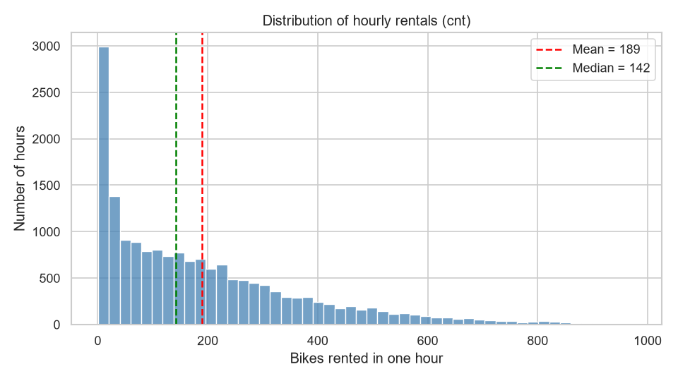

The first graph shows how hourly bike rentals are distributed across the dataset. Most hours have relatively lower rental counts, while a smaller number of hours have much higher counts. This can also be seen from the mean of 189.5 being higher than the median of 142. The distribution is right-skewed, which means that high-demand hours are less common but still important for prediction.

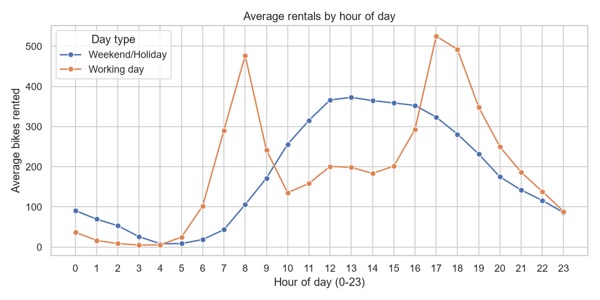

This graph helped me understand how bicycle usage changes throughout the day. The highest average demand is observed at 17:00, followed by 18:00 and 08:00. These hours are closely related to normal commuting times.

An interesting observation is that working days and weekends have different demand patterns. Working days show two major peaks, one in the morning and another in the evening. Weekends, on the other hand, show a more noticeable midday increase. This difference is the reason I created the `hr_workingday` feature during preprocessing.

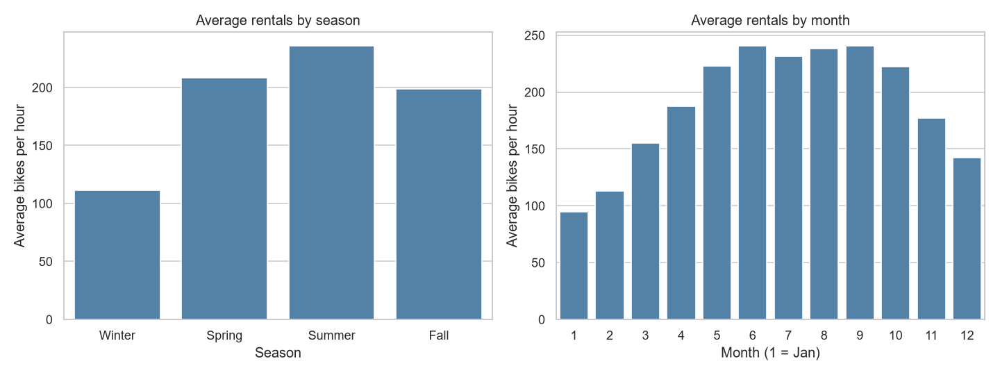

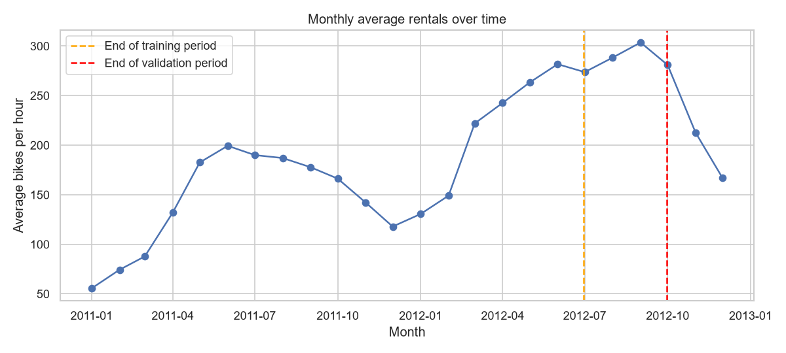

The seasonal analysis shows that bicycle rentals are not equally distributed throughout the year. Average hourly demand is highest in summer at 236.0, followed by spring at 208.3 and fall at 198.9. Winter has the lowest average demand at 111.1.

The monthly trend also shows a clear increase in bike usage in 2012. The average hourly rentals increased from 143.8 in 2011 to 234.7 in 2012, which is approximately a 63% increase. This change is important because it shows that demand can also change over time. It supports the decision to use a chronological split instead of randomly dividing the dataset.

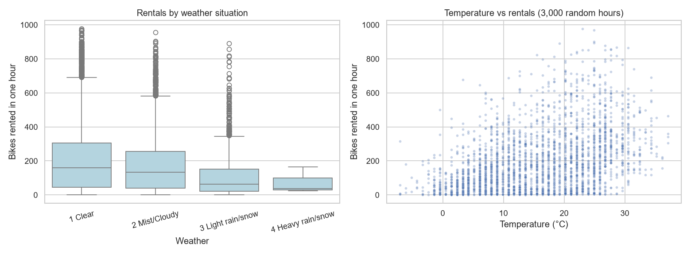

Weather conditions also have a relationship with bicycle rentals. The dataset contains the largest number of observations under clear weather conditions, followed by the other weather categories.

The correlation values show a positive relationship between temperature and rentals (0.405), while humidity has a negative relationship (-0.323). Weather situation also has a negative correlation with rentals (-0.142). Wind speed has a weak positive correlation of 0.093.

These values give an initial idea of how weather may influence demand, although correlation alone does not prove that one factor causes a change in rentals.

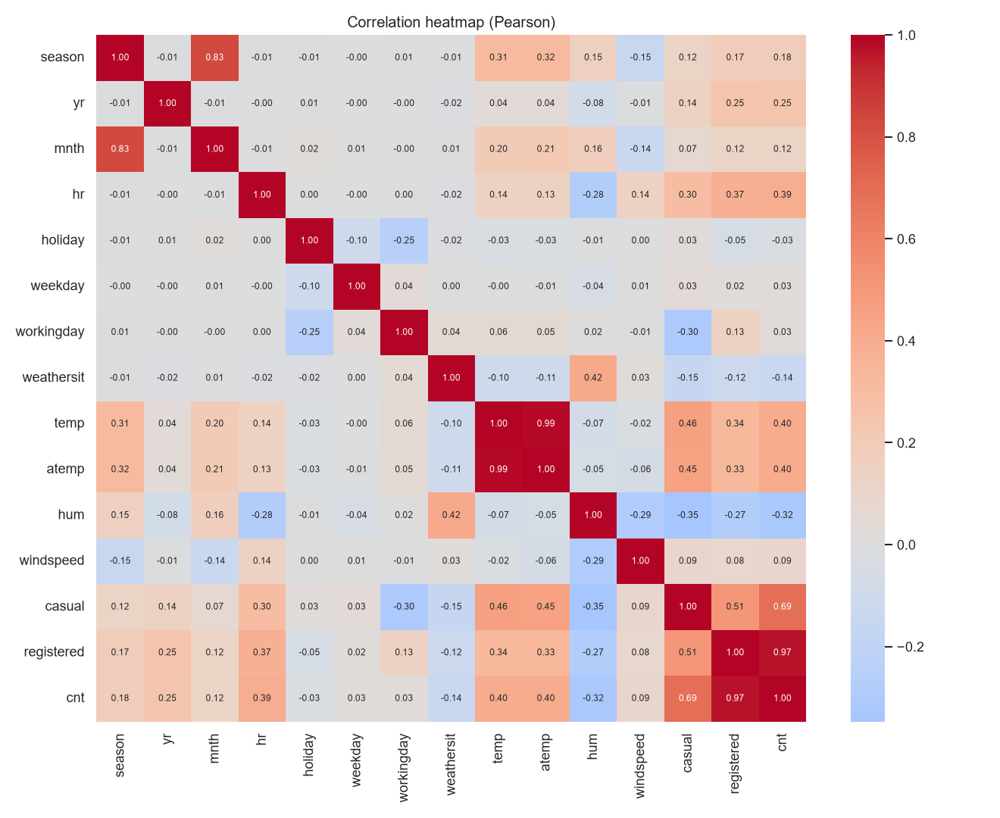

The correlation heatmap helped identify relationships between different columns. The `registered` and `casual` columns have high correlations with the total rental count `cnt`, with values of 0.972 and 0.695 respectively. This is expected because both columns are used to calculate the total number of rentals.

However, these columns cannot be used as input features when predicting `cnt`, because their values would reveal information about the target itself. This is why they were excluded from model training.

The correlation between `temp` and `atemp` is also very high at 0.988, which supports removing `atemp` to avoid unnecessary duplication of information.

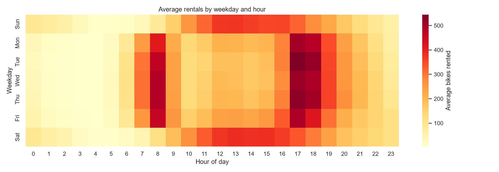

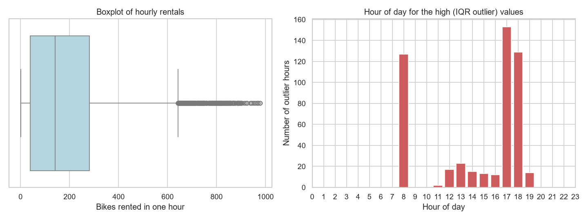

The analysis of missing hours showed that many absent records were concentrated around 29 and 30 October 2012. During this period, Capital Bikeshare suspended its service because of Hurricane Sandy. Some missing records were also found around 26 and 27 January 2011 during a snowstorm.

This observation helped explain why some hours were missing from the dataset. Instead of treating all missing hours as ordinary data errors, I considered the real-world events that affected the availability of the service.

## 7. Methodology

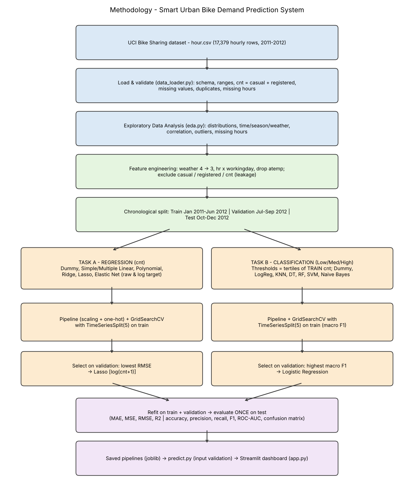

The project was completed in multiple stages, starting with data collection and ending with the deployment of the trained models.

1. **Data loading and validation:** The original dataset was loaded and checked for the expected columns, valid values, and correct rental counts.
2. **Exploratory Data Analysis:** I created graphs and examined the data to understand rental patterns, weather effects, seasonal changes, and missing hours.
3. **Feature engineering and preprocessing:** Useful features were created, unnecessary columns were removed, and the data was prepared according to the requirements of each algorithm.
4. **Model training:** Different regression and classification algorithms were trained using scikit-learn pipelines. Hyperparameters were tuned using `GridSearchCV` and `TimeSeriesSplit`.
5. **Model selection:** The validation results were compared to select the best-performing models for both tasks.
6. **Final evaluation:** The selected models were refitted using the training and validation data and evaluated on the test period.
7. **Model saving:** The final pipelines were saved using joblib along with their parameters, evaluation metrics, thresholds, package versions, and random seed.
8. **Dashboard development:** Finally, I developed a Streamlit application. It accepts user inputs, validates them, converts real-world units into the required dataset scale, and uses the saved models to generate predictions.

### Evaluation Metrics

For regression, I used MAE, MSE, RMSE, and R². MAE tells us the average absolute difference between actual and predicted rental counts. RMSE gives more importance to larger errors, while R² indicates how much variation in the target variable is explained by the model.

For classification, I used accuracy, precision, recall, macro F1-score, ROC-AUC, and the confusion matrix. These metrics help evaluate how correctly the models identify Low, Medium, and High demand hours.

## 8. Model Development

### 8.1 Regression (Task A)

| Model | Preprocessing | Hyperparameters searched | Notes |
|---|---|---|---|
| DummyRegressor | – | strategy = mean | baseline |
| Simple Linear | scaled temp only | – | one predictor (highest linear correlation) |
| Multiple Linear | scaled + one-hot | – | all features |
| Polynomial | + PolynomialFeatures on numerics | degree ∈ {2, 3} | |
| Ridge (L2) | polynomial degree 2 | alpha ∈ {0.1, 1, 10, 100} | shrinks coefficients |
| Lasso (L1) | polynomial degree 2 | alpha ∈ {0.001 … 10} | sets some coefficients to 0 |
| Elastic Net | polynomial degree 2 | alpha ∈ {0.001 … 1}, l1_ratio ∈ {0.2, 0.5, 0.8} | L1 + L2 |

For the regression task, I trained the models using both the original rental count (`cnt`) and its log-transformed version (`log(cnt + 1)`). This allowed me to compare whether transforming the target could improve prediction performance.

I included simple and multiple linear regression to establish basic results, followed by polynomial regression to capture possible non-linear relationships. Ridge, Lasso, and Elastic Net were also tested to understand how regularisation affects model performance.

For predictions, negative rental counts were clipped to zero because a negative number of rented bicycles is not possible in a real situation.

### 8.2 Classification (Task B)

| Model | Preprocessing | Hyperparameters searched |
|---|---|---|
| DummyClassifier | – | most frequent |
| Logistic Regression | scaled + one-hot | C ∈ {0.1, 1, 10} |
| KNN | scaled + one-hot | k ∈ {5, 15, 31}, weights ∈ {uniform, distance} |
| Decision Tree | raw | max_depth ∈ {5, 10, 15, None}, min_samples_leaf ∈ {1, 5, 20} |
| Random Forest (200 trees) | raw | max_depth ∈ {10, 20, None}, min_samples_leaf ∈ {1, 5} |
| SVM (RBF) | scaled + one-hot | C ∈ {0.1, 1, 10}; probabilities via CalibratedClassifierCV |
| Gaussian Naive Bayes | scaled + one-hot (dense) | var_smoothing ∈ {1e-9, 1e-6, 1e-3} |

For classification, I trained six different machine learning algorithms along with a Dummy Classifier as a baseline. The models were used to predict whether an hour belongs to the Low, Medium, or High demand category.

The training data was divided into three nearly equal demand groups using thresholds calculated from the training period. Since these classes were balanced by construction, I did not apply additional resampling or class weighting.

A random seed of 42 was used throughout the experiments to maintain consistency in the results.

## 9. Results and Model Comparison

### 9.1 Regression – Validation (Selection)

| Model | Target | Train RMSE | CV RMSE | Val MAE | Val RMSE | Val R² | Best params |
|---|---|---:|---:|---:|---:|---:|---|
| **Lasso** | **log** | 52.92 | 85.61 | **47.55** | **74.44** | **0.8962** | α = 0.001 |
| Elastic Net | log | 52.60 | 85.25 | 47.65 | 75.36 | 0.8936 | α = 0.001, l1 = 0.2 |
| Ridge | log | 52.36 | 85.42 | 50.16 | 80.95 | 0.8772 | α = 0.1 |
| Polynomial | log | 52.37 | 85.43 | 50.20 | 81.03 | 0.8770 | degree 2 |
| Multiple Linear | log | 60.92 | 94.55 | 65.89 | 109.47 | 0.7755 | – |
| Polynomial | raw | 63.35 | 87.11 | 84.09 | 110.12 | 0.7729 | degree 2 |
| Ridge | raw | 63.35 | 87.15 | 84.10 | 110.13 | 0.7728 | α = 0.1 |
| Lasso | raw | 63.36 | 86.71 | 84.11 | 110.14 | 0.7728 | α = 0.001 |
| Elastic Net | raw | 63.41 | 87.41 | 84.45 | 110.60 | 0.7708 | α = 0.001, l1 = 0.8 |
| Multiple Linear | raw | 64.59 | 87.34 | 87.05 | 113.79 | 0.7575 | – |
| Simple Linear (temp) | raw | 146.15 | 157.13 | 174.29 | 227.34 | 0.0319 | – |
| Simple Linear (temp) | log | 162.55 | 174.17 | 183.84 | 252.84 | −0.1975 | – |
| Dummy (mean) | raw | 160.78 | 173.97 | 197.83 | 260.65 | −0.2726 | – |

### 9.2 Regression – Test (Evaluated Once)

| Model | Target | MAE | MSE | RMSE | R² |
|---|---|---:|---:|---:|---:|
| **Lasso (selected)** | log | **42.49** | 4585.6 | **67.72** | **0.8872** |
| Ridge | log | 40.72 | 4415.7 | 66.45 | 0.8913 |
| Polynomial | log | 40.72 | 4416.6 | 66.46 | 0.8913 |
| Elastic Net | log | 41.56 | 4455.6 | 66.75 | 0.8904 |
| Multiple Linear | log | 43.04 | 4955.2 | 70.39 | 0.8781 |
| Multiple Linear | raw | 68.63 | 8991.7 | 94.82 | 0.7787 |
| Ridge / Polynomial / Lasso | raw | 70.66–70.68 | ≈9220 | 96.02–96.03 | 0.7731 |
| Elastic Net | raw | 70.85 | 9244.5 | 96.15 | 0.7725 |
| Simple Linear (temp) | raw | 145.09 | 41570.7 | 203.89 | −0.0230 |
| Dummy (mean) | raw | 156.87 | 41790.9 | 204.43 | −0.0284 |
| Simple Linear (temp) | log | 171.75 | 59342.2 | 243.60 | −0.4603 |

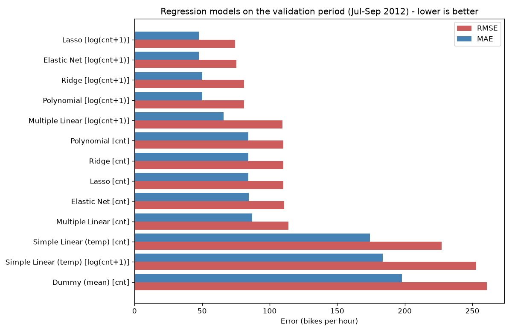

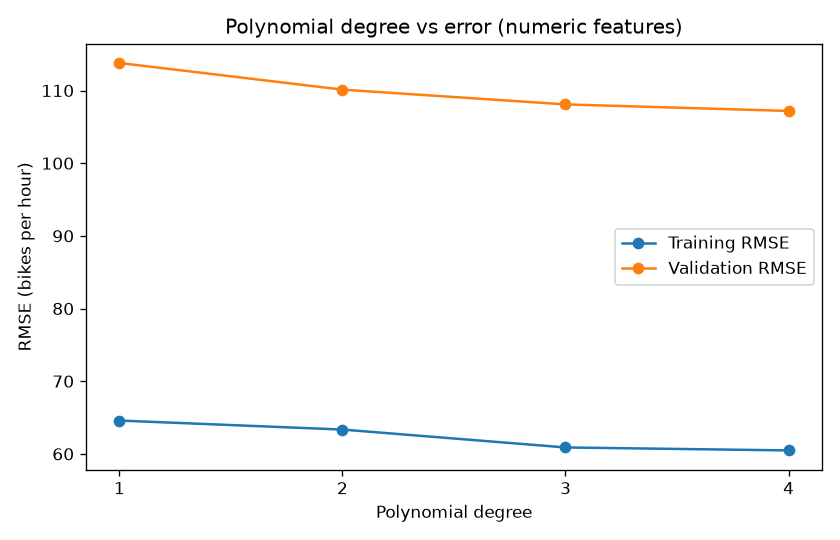

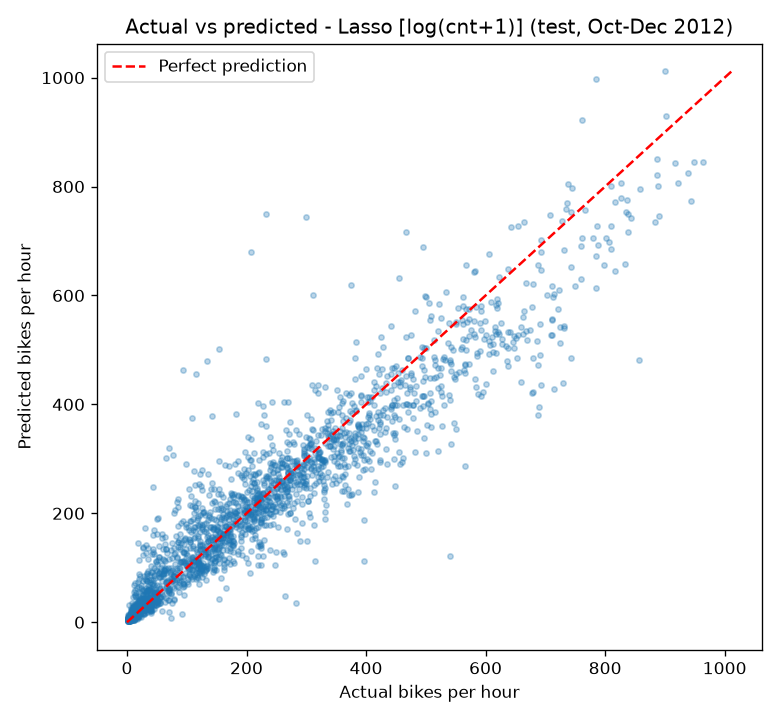

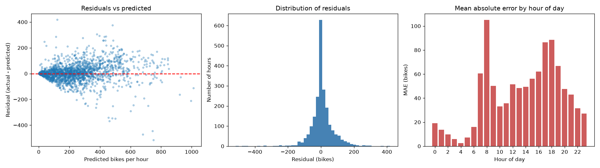

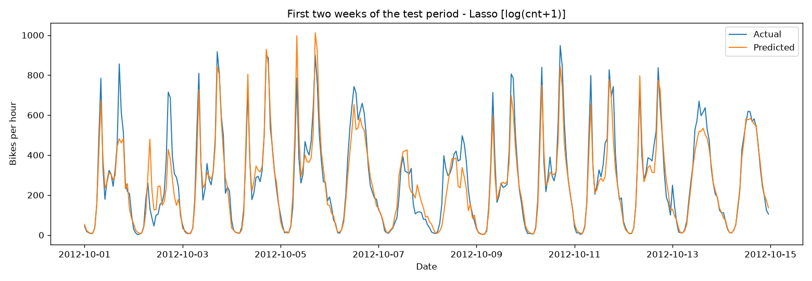

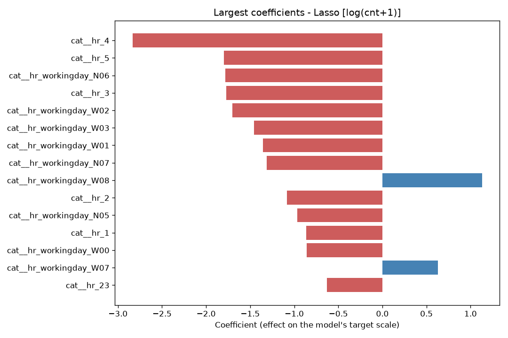

**Regression Analysis**

The regression results show that using a log-transformed target improved the prediction performance considerably. Among the models selected during validation, Lasso with a log-transformed target was chosen for the final system.

On the test data, this model achieved an MAE of 42.49 bikes and an RMSE of 67.72, with an R² score of 0.8872. Compared with the Dummy Regressor baseline, its MAE decreased from 156.87 to 42.49, which is approximately a 73% reduction.

One observation from the experiments was that Simple Linear Regression using only temperature did not perform well. This suggests that temperature alone is not enough to explain bike rental demand. Factors such as the hour of the day and whether it is a working day also play an important role.

Lasso also reduced the number of active coefficients by setting 37 out of 110 coefficients to zero. This shows how regularisation can help reduce the contribution of less useful features.

The error analysis showed that predictions were more accurate during night hours, where MAE ranged from 2.5 to 19 bikes. Errors were higher during commuting hours, especially at 08:00, 17:00, and 18:00. These are also the periods with higher rental demand.

It is worth mentioning that Ridge and Polynomial Regression achieved slightly better test MAE values than Lasso. However, Lasso was selected using the validation results, and I kept that selection unchanged. This was done to avoid choosing a model based on the test results. The difference between the leading log-transformed models was relatively small.

### 9.3 Classification – Validation (Selection)

| Model | CV F1 | Train F1 | Accuracy | Precision | Recall | **Macro F1** | ROC-AUC |
|---|---:|---:|---:|---:|---:|---:|---:|
| **Logistic Regression (C = 10)** | 0.7819 | 0.8715 | 0.9207 | 0.8968 | 0.8881 | **0.8922** | 0.9800 |
| Random Forest | 0.7279 | 1.0000 | 0.9004 | 0.8612 | 0.8924 | 0.8743 | 0.9767 |
| Decision Tree (depth 10, leaf 20) | 0.7494 | 0.8627 | 0.8981 | 0.8579 | 0.8744 | 0.8656 | 0.9719 |
| Naive Bayes | 0.7741 | 0.6649 | 0.8922 | 0.8434 | 0.8673 | 0.8543 | 0.9655 |
| SVM (RBF, C = 10) | 0.7354 | 0.9753 | 0.8718 | 0.8370 | 0.8751 | 0.8493 | 0.9563 |
| KNN (k = 15, distance) | 0.6883 | 1.0000 | 0.7948 | 0.7757 | 0.8377 | 0.7824 | 0.9462 |
| Dummy | 0.1492 | 0.1671 | 0.6010 | 0.2003 | 0.3333 | 0.2503 | 0.5000 |

### 9.4 Classification – Test (Evaluated Once)

| Model | Accuracy | Precision | Recall | **Macro F1** | ROC-AUC |
|---|---:|---:|---:|---:|---:|
| **Logistic Regression (selected)** | 0.8386 | 0.8374 | 0.8041 | **0.8160** | 0.9461 |
| SVM (RBF) | 0.8372 | 0.8285 | 0.8183 | 0.8217 | 0.9441 |
| Random Forest | 0.8326 | 0.8197 | 0.8133 | 0.8158 | 0.9477 |
| Decision Tree | 0.8072 | 0.7851 | 0.7786 | 0.7802 | 0.9142 |
| KNN | 0.7500 | 0.7624 | 0.7669 | 0.7498 | 0.9186 |
| Naive Bayes | 0.7735 | 0.7883 | 0.7114 | 0.7217 | 0.8736 |
| Dummy | 0.4589 | 0.1530 | 0.3333 | 0.2097 | 0.5000 |

Per class (selected model, test):

- Low: Precision 0.962 / Recall 0.838 / F1 0.896 (636 hours)
- Medium: Precision 0.727 / Recall 0.615 / F1 0.666 (537 hours)
- High: Precision 0.823 / Recall 0.960 / F1 0.886 (995 hours)

Confusion matrix (rows actual, columns predicted; Low/Medium/High):

```text
[[533, 86, 17],
 [19, 330, 188],
 [2, 38, 955]]
```

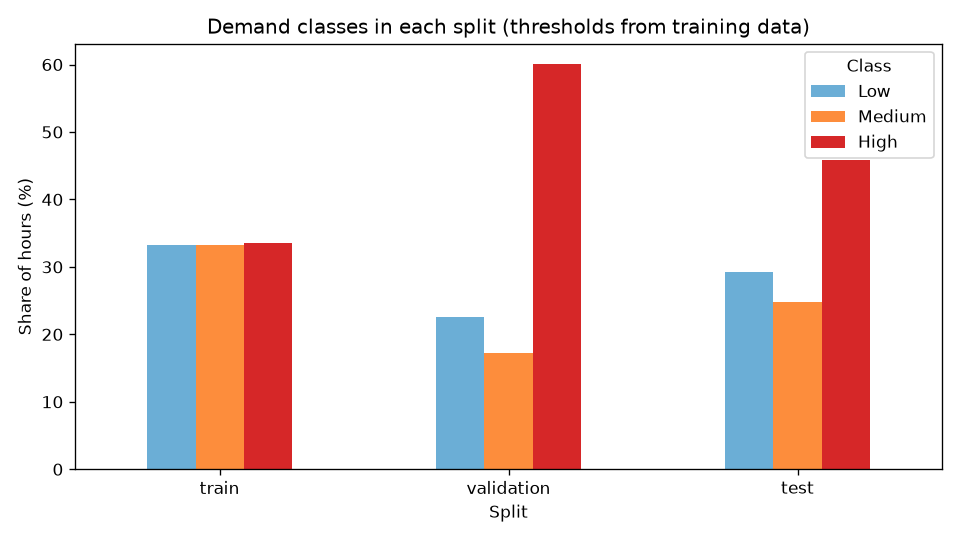

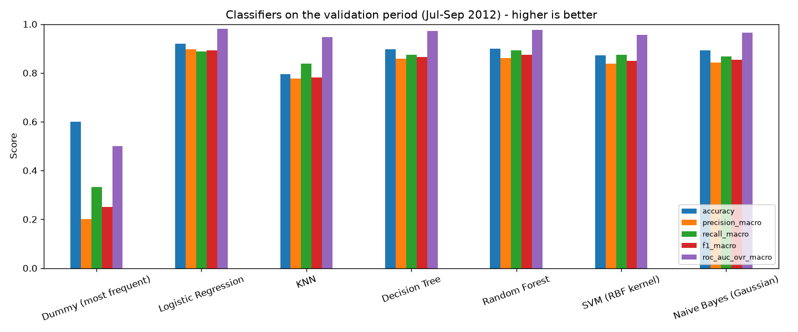

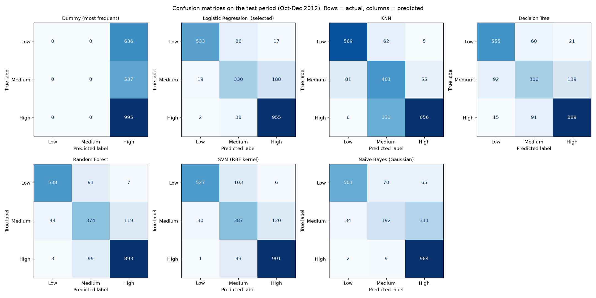

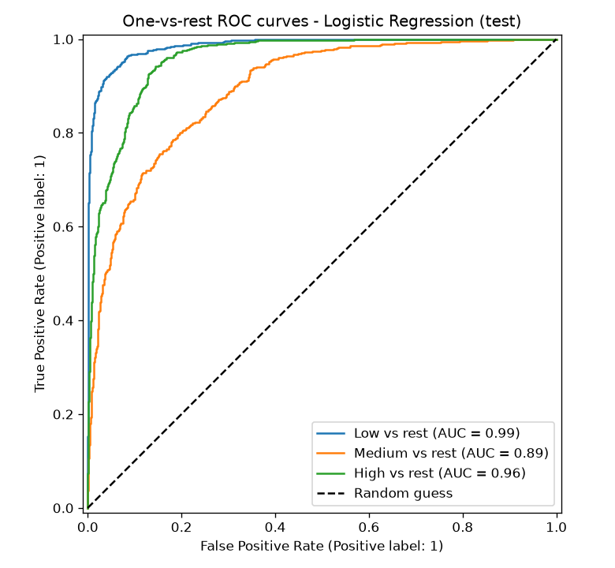

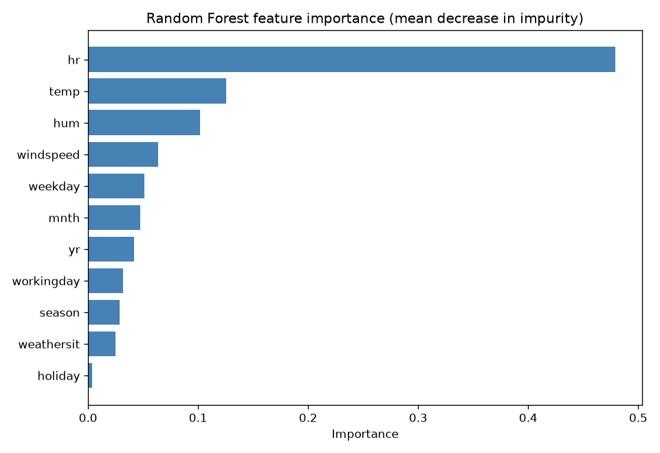

**Classification Analysis**

The classification results show that Logistic Regression performed well on the validation data and was selected for the final model. On the test data, it achieved an accuracy of 0.8386 and a macro F1-score of 0.8160. Its one-vs-rest ROC-AUC score was 0.9461.

The results also show why accuracy should not be considered the only measure of classification performance. The Dummy Classifier achieved an accuracy of 0.4589 on the test data, but its macro F1-score was only 0.2097. Macro F1 is useful here because it gives equal importance to all three demand categories.

Among the three categories, the model found Low and High demand hours easier to identify than Medium demand hours. The F1-score for Medium was 0.666, compared with 0.896 for Low and 0.886 for High. Most of the Medium-class errors occurred when the model predicted High demand instead.

The confusion matrix also helps explain these mistakes. Out of 537 actual Medium-demand hours, 188 were predicted as High. However, only a small number of hours were confused directly between Low and High.

I also observed that some models, such as Random Forest and KNN, achieved a training F1-score of 1.000 but performed less strongly on validation data. This is a sign that they may have overfitted the training data.

The scaling experiment with KNN showed that preprocessing made a noticeable difference. Validation macro F1 increased from 0.6559 without scaling to 0.7411 after applying StandardScaler.

Although SVM achieved a slightly higher macro F1-score than Logistic Regression on the test data, Logistic Regression was retained because it had been selected using validation performance. The final model selection was not changed after examining the test results.

### 9.5 Dashboard

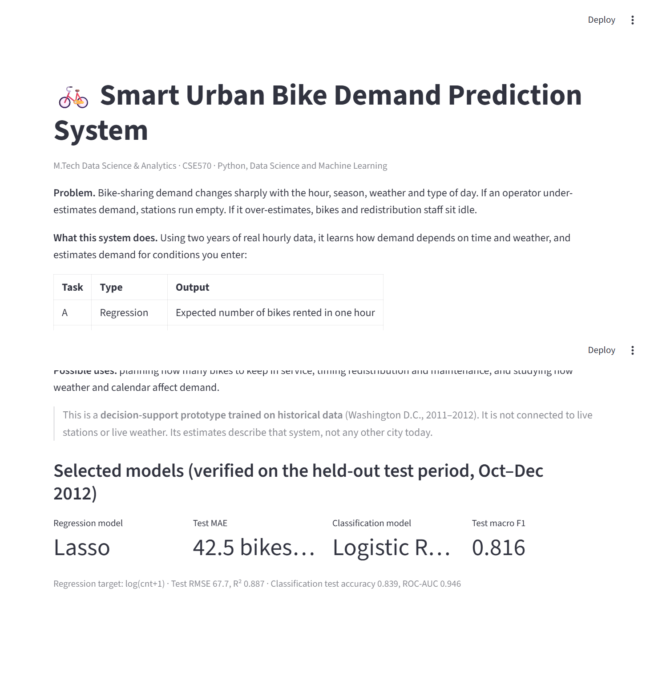

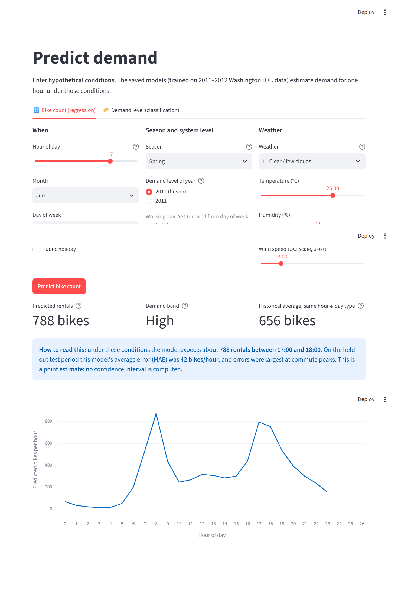

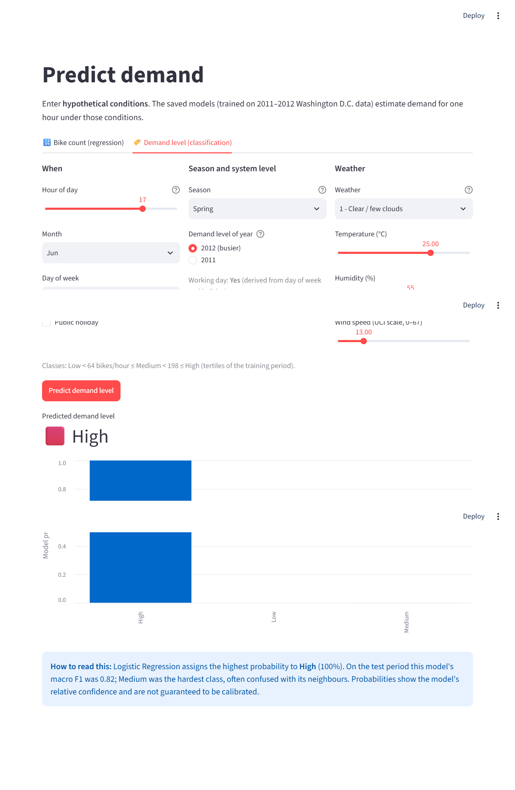

Example (regression form): Wednesday, June, 17:00, 2012 level, clear weather, 25 °C, 55% humidity → predicted 788 bikes (High). The historical average for the same hour and day type in 2012 is 656.

### 9.6 Testing

I also tested the project to check whether its important components were working correctly. A total of 30 automated tests were executed successfully using pytest.

These tests cover different parts of the system, including dataset structure, data leakage prevention, chronological data splitting, feature engineering, user input validation, unit conversion, saved-model loading, and prediction generation.

The tests also check whether incorrect data types and values outside the accepted ranges are rejected. This helped verify that the application was not only producing predictions but was also handling inputs properly.

## 10. Conclusion and Limitations

### 10.1 Findings

The main aim of this project was to understand and predict hourly bike-sharing demand using machine learning. During the analysis, I found that the hour of the day and the type of day have a strong relationship with bicycle rentals. Temperature, humidity, season, and the growth in usage over time also affect demand.

For the regression task, Lasso with a log-transformed target achieved an MAE of 42.49 and an R² score of 0.8872 on the test data. For the classification task, Logistic Regression achieved a macro F1-score of 0.8160.

Both selected models performed better than their respective baseline models. The experiments also showed the importance of using the correct preprocessing steps and evaluating the models in chronological order.

One important learning from this project was that getting a good model score is not the only goal. It is equally important to prepare the data correctly, avoid leakage, compare different models fairly, and evaluate the final model on data that was not used during training or model selection.

### 10.2 Practical Relevance

The Streamlit dashboard makes the project easier to use because a person does not need to write code or run the model manually to generate a prediction. By entering different time and weather conditions, users can explore how the expected bike demand changes.

Such predictions can support planning activities like estimating bicycle requirements, arranging redistribution, and understanding periods of high demand. The current dashboard is a prototype and would need updated local data and further testing before being used in an actual bike-sharing operation.

### 10.3 Limitations

Although the project produced useful results, there are some limitations that should be considered:

- The dataset contains historical records from Washington D.C. for 2011–2012, so the results may not represent present-day demand or the conditions of other cities.
- The project uses observed weather information rather than actual weather forecasts.
- The year feature covers only 2011 and 2012, which limits the model's ability to estimate long-term changes in demand.
- The classification thresholds are based on the training data and remain fixed, even when the demand distribution changes over time.
- The test period covers October to December 2012 and includes the service interruption caused by Hurricane Sandy.
- The models provide point predictions and do not currently provide prediction intervals.
- The project predicts system-wide demand rather than demand for individual bike-sharing stations.

### 10.4 Future Improvements

There are several ways in which this project can be improved in the future.

One possible improvement is to use more recent bike-sharing data from Indian cities. This would make it possible to study local conditions such as monsoon seasons, festivals, holidays, and city-specific travel patterns.

The system could also be connected to live station information through an operator feed such as GBFS and to a weather forecasting API. This would make the predictions more useful for real-time planning.

Other possible improvements include experimenting with gradient-boosting regression models, testing a wider range of regularisation values, and adding prediction intervals to show the possible range of demand.

Further work could also include permutation-based feature importance, ordinal classification, and station-level demand forecasting. These improvements could make the system more informative and useful for practical bike-sharing operations.

## 11. References

1. Fanaee-T, H. (2013). *Bike Sharing* [Dataset]. UCI Machine Learning Repository. https://doi.org/10.24432/C5W894

2. Fanaee-T, H., & Gama, J. (2014). Event labeling combining ensemble detectors and background knowledge. *Progress in Artificial Intelligence, 2*(2–3), 113–127. https://doi.org/10.1007/s13748-013-0040-3

3. Pedregosa, F., et al. (2011). Scikit-learn: Machine learning in Python. *Journal of Machine Learning Research, 12*, 2825–2830.

4. Harris, C. R., et al. (2020). Array programming with NumPy. *Nature, 585*, 357–362.

5. McKinney, W. (2010). Data structures for statistical computing in Python. *Proceedings of the 9th Python in Science Conference*, 56–61.

6. Hunter, J. D. (2007). Matplotlib: A 2D graphics environment. *Computing in Science & Engineering, 9*(3), 90–95.

7. Waskom, M. L. (2021). seaborn: Statistical data visualization. *Journal of Open Source Software, 6*(60), 3021.

8. Hoerl, A. E., & Kennard, R. W. (1970). Ridge regression: Biased estimation for nonorthogonal problems. *Technometrics, 12*(1), 55–67.

9. Tibshirani, R. (1996). Regression shrinkage and selection via the lasso. *Journal of the Royal Statistical Society: Series B, 58*(1), 267–288.

10. Zou, H., & Hastie, T. (2005). Regularization and variable selection via the elastic net. *Journal of the Royal Statistical Society: Series B, 67*(2), 301–320.

11. Breiman, L. (2001). Random forests. *Machine Learning, 45*, 5–32.

## 12. GitHub and LinkedIn Evidence

| Item | Value |
|---|---|
| GitHub repository | [https://github.com/Ayushi1-p/smart-urban-bike-demand](https://github.com/Ayushi1-p/smart-urban-bike-demand) |
| Live demo | [https://smart-urban-bike-demand-ayushi.streamlit.app/](https://smart-urban-bike-demand-ayushi.streamlit.app/) |
| LinkedIn post | [https://lnkd.in/p/g7SqZ_Xw](https://lnkd.in/p/g7SqZ_Xw) |